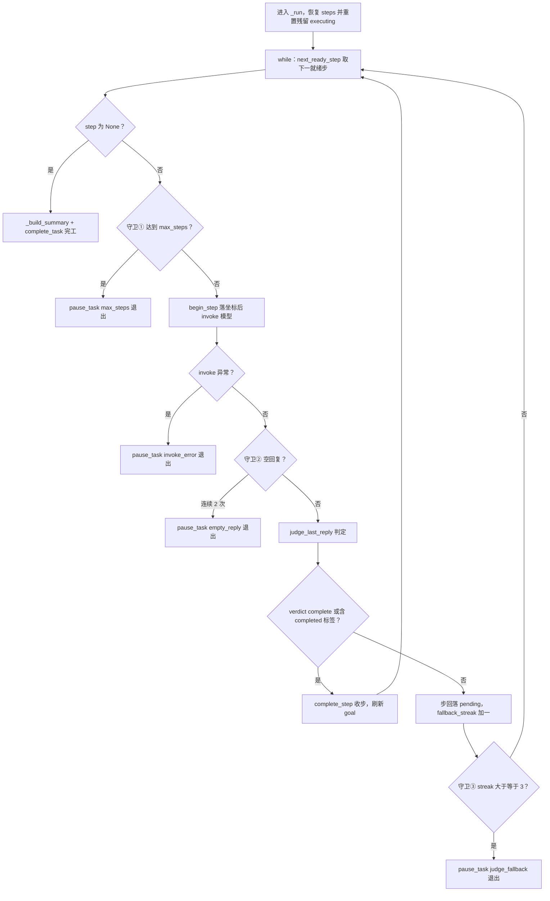

# agents/goal/goal\_loop.py — goal\_loop.py

> **文件路径**
>
> : 
>
> `backend/packages/harness/agentflow/agents/goal/goal_loop.py`
> **目录位置**
>
> : agents → goal → goal_loop.py
> **职责**
>
> : 长任务外部 while 闭环引擎（M5）—— 计划生成 → 拓扑排序 → 逐步执行 → 汇总报告（同步）

## 📑 目录


* [📋 结构图](#📋-结构图)

* [📤 关键导出](#📤-关键导出)

* [💡 设计思想](#💡-设计思想)

* [🎯 实用场景](#🎯-实用场景)

* [📊 顺序执行链流程图](#📊-顺序执行链流程图)

* [🧩 代码解析（成块对照 goal\_loop.py）](#🧩-代码解析成块对照-goal_looppy)

* [❓ Q\&A / 知识点](#❓-qa--知识点)

* [⚠️ 风险点](#⚠️-风险点)

## 📋 结构图


```
┌──────────────────────────────────────────────────────────────┐

│ \_ai\_text(resp) -> str        取 invoke 返回最后一条消息文本    │

│                                                             │

│ GoalEngine(agent, model, goal\_repo, service=None)           │

│   \_\_init\_\_   service 缺省自动包 GoalStateService(goal\_repo)  │

│   start(thread\_id, goal\_text, max\_steps=12)                 │

│     建 goal 行 -> begin\_planning -> preamble invoke ->       │

│     parse+topo\_sort -> finalize\_plan -> begin\_execution -> \_run │

│   resume(thread\_id)                                         │

│     get\_active\_by\_thread -> 恢复 steps -> paused 则 resume\_task -> \_run │

│   \_run(thread\_id, goal)                                     │

│     while: next\_ready\_step -> None 则 complete\_task          │

│     三守卫：max\_steps / 空回复×2 / fallback\_streak≥3 -> paused │

│   \_build\_summary(goal, steps)  完工汇总字符串                │

└──────────────────────────────────────────────────────────────┘
```

**调用链（Grep 自 agentflow. 核实）**：


* **谁调用它**：`cli/main.py` —— try/except 双路径导入（规范路径 `agentflow.agents.goal.goal_loop`，

  except 回退 `agentflow.goal.goal_loop`，line 122-125）；line 347 `GoalEngine(agent, model, goal_repo)`

  构造，line 379 `engine.resume(thread_id)`（--thread 断点恢复），line 383 `engine.start(thread_id, args.goal)`

  （--goal 入口）。测试 `tests/test_goal_resume.py` / `test_goal_graph.py` 也直接构造 GoalEngine。

* **它调用谁**：`plans.service.GoalStateService`（状态迁移）、`plans.resolver`（topo\_sort/next\_ready\_step/

  PlanCycleError）、`plans.types`（parse\_steps\_json/steps\_to\_json/steps\_from\_json/PlanStep）、

  `goal_prompts`（build\_goal\_mode\_preamble/build\_continue\_nudge）、`goal_judge.judge_last_reply`、

  `goal_state`（STEP\_STATUS\_\*、GoalRow、goal\_row\_from\_row）、`GoalRepository`（create/get/begin\_step/

  update\_plan/complete\_step/complete\_goal/get\_active\_by\_thread）。

## 📤 关键导出

**函数（内部）**


* `_ai_text()`

**类**


* `GoalEngine`

## 💡 设计思想


1. 外部 while 闭环：M5 砍掉 evoflow 原版的 goal\_graph/middleware after\_model 钩子 jump\_to 伪图，

   改同步外部 while—— 对齐 CLI 同步主循环，逻辑直白可调试。

2. 写序固定（R3）：先 `agent.invoke`（checkpointer 落消息）→ 再写步状态 SQL；恢复以 SQL 的

   completed\_steps/current\_step 为坐标，checkpointer 只管消息，两者职责不混。

3. 断点重跑幂等：resume 时把 plan\_steps\_json 里残留 `executing` 的步重置回 `pending`—— 杀进程最坏

   发生在 "步已开跑未落完成"，幂等 nudge 重跑该步可接受。

4. 三守卫熔断 paused：步数上限 / 空回复 ×2 /fallback\_streak≥3，任一命中都 pause\_task 退出，

   \--thread 可续跑，绝不崩 CLI。

## 🎯 实用场景


1. 新长任务：`--goal "写一份周报"` → start 自动拆计划、逐步执行、汇总完工再进 REPL。

2. 断点续跑：进程被杀 / 熔断后，`--thread <id>` 重启 → resume 从下一步接着跑，已完成步不重跑。

## 📊 顺序执行链流程图（\_run 逐步闭环一圈）


```
\_resume/start 进入 \_run(thread\_id, goal)（request：逐步执行直到完工或熔断）

│

▼

steps = steps\_from\_json(plan\_steps\_json)；把残留 executing 的步重置 pending（断点重跑）

│

▼

while True: step = next\_ready\_step(steps)

│   step is None -> \_build\_summary + complete\_task 完工，return

▼

守卫①：goal.completed\_steps >= max\_steps -> pause\_task("max\_steps")，return

│

▼

step.status=executing -> repo.begin\_step 落坐标（current\_step + plan\_steps\_json）

│

▼

nudge = build\_continue\_nudge(step) -> agent.invoke（先 invoke，R3 写序）

│   invoke 抛异常 -> pause\_task("invoke\_error:...")，return

▼

text = \_ai\_text(resp)

│

▼

守卫②：text 空 -> empty\_retries+=1；步回落 pending；>=2 次 pause\_task("empty\_reply")，return

│

▼

verdict = judge\_last\_reply(model, text)

│   verdict==complete 或文本含 \<completed> -> step.status=completed

│       service.complete\_step 落库；fallback\_streak=0；刷新 goal

│   否则 -> step.status=pending；fallback\_streak+=1

│       守卫③：>=3 -> pause\_task("judge\_fallback")，return

▼

回到 while 顶部，取下一就绪步
```

**Mermaid 版（GitHub / 飞书渲染；VSCode 需装插件）**：




## 🧩 代码解析（成块对照 goal\_loop.py）

> 读法：每块先贴
>
> **完整代码**
>
> ，再看块下方的整块解析。代码与文件逐字一致。

### 块 1：imports —— 拼装 M5 全部子模块


```
from \_\_future\_\_ import annotations

import os

from langchain\_core.messages import HumanMessage

from agentflow.agents.goal.goal\_judge import judge\_last\_reply

from agentflow.agents.goal.goal\_prompts import (

&#x20;   build\_continue\_nudge,

&#x20;   build\_goal\_mode\_preamble,

)

from agentflow.agents.goal.goal\_state import (

&#x20;   STEP\_STATUS\_COMPLETED,

&#x20;   STEP\_STATUS\_EXECUTING,

&#x20;   STEP\_STATUS\_PENDING,

&#x20;   GoalRow,

&#x20;   goal\_row\_from\_row,

)

from agentflow.plans.resolver import PlanCycleError, next\_ready\_step, topo\_sort

from agentflow.plans.service import GoalStateService

from agentflow.plans.types import (

&#x20;   PlanStep,

&#x20;   parse\_steps\_json,

&#x20;   steps\_from\_json,

&#x20;   steps\_to\_json,

)
```

**结构简析**：goal\_loop 是 M5 的 "装配中心"——import 了 plans 包（types/resolver/service）和

agents.goal 包（prompts/judge/state）的几乎全部对外符号；`os` 用于 `os.urandom` 生成 goal\_id。

这份 import 清单本身就是 M5 长任务域的依赖拓扑。

**函数参数逐条解释**：本块无函数，仅拼装 imports。

**落库要点**：loop 在依赖最顶层，向下依赖计划域与判定域，不被其他业务模块反向依赖（只被 cli 入口调用）。

### 块 2：\_ai\_text —— 从 invoke 返回取最后一条消息文本


```
def \_ai\_text(resp: dict) -> str:

&#x20;   """从 agent.invoke 返回里取最后一条消息的文本内容。"""

&#x20;   messages = (resp or {}).get("messages") or \[]

&#x20;   if not messages:

&#x20;       return ""

&#x20;   last = messages\[-1]

&#x20;   content = getattr(last, "content", last)

&#x20;   if isinstance(content, str):

&#x20;       return content

&#x20;   # 多模态块列表：拼成文本

&#x20;   return str(content)
```

**结构简析**：纯工具函数 ——invoke 返回是带 `messages` 键的 dict（checkpointer 累积的消息链），

取 `messages[-1]` 即模型最新回复；三层空值兜底 + content 类型兼容。

`_ai_text()`**&#x20;参数逐条解释**：


| 参数     | 类型     | 默认值 | 含义                                                                                                                                                                                                                 |
| ------ | ------ | --- | ------------------------------------------------------------------------------------------------------------------------------------------------------------------------------------------------------------------ |
| `resp` | `dict` | 必填  | `agent.invoke` 的返回；函数 `(resp or {}).get("messages") or []` 三层空值兜底（resp 为 None /messages 键缺失 / 空列表都安全返回空串），取 `messages[-1]` 后 `getattr(last,"content",last)` 兼容 AIMessage 对象与裸字符串；content 非 str（多模态块列表）则 `str()` 强转 |

**落库要点**：空串会被 `_run` 的守卫②（空回复累计）接住 —— 本函数本身不判错，只负责 "安全取文本"。

### 块 3：GoalEngine.**init** —— 装配与 service 自动建立


```
class GoalEngine:

&#x20;   """长任务引擎：计划生成 → 拓扑排序 → 逐步执行 → 汇总报告（同步）。"""

&#x20;   def \_\_init\_\_(

&#x20;       self, agent, model, goal\_repo, service: GoalStateService | None = None

&#x20;   ):

&#x20;       """装配：agent=主 Agent（sync invoke），model=判定模型，goal\_repo=落库。

&#x20;       service 缺省时自动建一个包 goal\_repo 的 GoalStateService——

&#x20;       goal\_loop 一律经 service 走迁移（服务层守卫，repo 原语）。

&#x20;       """

&#x20;       self.\_agent = agent

&#x20;       self.\_model = model

&#x20;       self.\_repo = goal\_repo

&#x20;       self.\_service: GoalStateService = service or GoalStateService(goal\_repo)
```

**结构简析**：`GoalEngine` 四件套装配 ——`agent`（主 Agent，sync invoke）、`model`（判定模型）、

`goal_repo`（落库原语）、`service`（可选注入）。关键是 `service or GoalStateService(goal_repo)`：

调用方不传时自动包一个，强制所有状态迁移都过 service 守卫。

`__init__()`**&#x20;参数逐条解释**：


| 参数          | 类型                         | 默认值    | 含义                                                                                                             |
| ----------- | -------------------------- | ------ | -------------------------------------------------------------------------------------------------------------- |
| `agent`     | （sync compiled graph）      | 必填     | 主 Agent；引擎内 `self._agent` 用于 preamble /nudge 的 sync invoke（勿改 async，与 CLI 同步主循环对齐）                             |
| `model`     | （langchain chat model）     | 必填     | 判定模型；引擎内 `self._model` 喂给 `judge_last_reply` 做逐步验收                                                             |
| `goal_repo` | `GoalRepository`           | 必填     | 落库原语；引擎内 `self._repo` 调 `create`/`get`/`begin_step`/`get_active_by_thread` 等 SQL                               |
| `service`   | `GoalStateService \| None` | `None` | 状态迁移服务层；缺省时自动 `GoalStateService(goal_repo)`——goal\_loop 一律经 service 走迁移（服务层守卫，repo 原语）。测试会显式注入假 service 断言迁移路径 |

**落库要点**：cli 只传前三个参数，靠自动建的 service；状态迁移（begin\_planning/finalize\_plan/

begin\_execution/complete\_step/complete\_task/pause\_task/resume\_task/fail\_task）全部走 service，

引擎里没有一处裸 patch。

### 块 4：start —— 新长任务入口


```
&#x20;   # ---------- 入口 ----------

&#x20;   def start(self, thread\_id: str, goal\_text: str, max\_steps: int = 12) -> None:

&#x20;       """启动一个新长任务（全程同步跑完或断点 paused 退出）。"""

&#x20;       goal\_id = "g\_" + os.urandom(6).hex()

&#x20;       self.\_repo.create(

&#x20;           goal\_id,

&#x20;           thread\_id,

&#x20;           goal\_text,

&#x20;           goal\_status="pending",

&#x20;           plan\_steps\_json="\[]",

&#x20;           max\_steps=max\_steps,

&#x20;           completed\_steps=0,

&#x20;       )

&#x20;       self.\_service.begin\_planning(goal\_id)  # pending → planning

&#x20;       # ① 首转：preamble 引导模型吐 JSON 计划

&#x20;       preamble = build\_goal\_mode\_preamble(goal\_text)

&#x20;       resp = self.\_agent.invoke(

&#x20;           {"messages": \[HumanMessage(preamble)]},

&#x20;           config={"configurable": {"thread\_id": thread\_id}},

&#x20;       )

&#x20;       last\_ai\_text = \_ai\_text(resp)

&#x20;       # ② 解析 + 拓扑校验

&#x20;       try:

&#x20;           steps = parse\_steps\_json(last\_ai\_text)

&#x20;           steps = topo\_sort(steps)

&#x20;       except (ValueError, PlanCycleError) as exc:

&#x20;           self.\_service.fail\_task(goal\_id, last\_error=f"计划解析失败: {exc}"\[:300])

&#x20;           print(f"\[长任务] 计划生成失败: {exc}")

&#x20;           return

&#x20;       # ③ 落计划 → 自动授权执行

&#x20;       self.\_service.finalize\_plan(goal\_id, steps\_to\_json(steps))  # planning → planned

&#x20;       self.\_service.begin\_execution(goal\_id)  # planned → executing（M5 自动授权）

&#x20;       row = self.\_repo.get(goal\_id)

&#x20;       self.\_run(thread\_id, goal\_row\_from\_row(row))
```

**结构简析**：start 三段式 ——①建 goal 行（`g_`+6 字节随机 hex，初始 pending、plan\_steps\_json="\[]"）

后 `begin_planning`；②preamble invoke 首转 → `parse_steps_json`+`topo_sort`，**任何**

**ValueError/PlanCycleError 都 catch 住&#x20;**`fail_task`**&#x20;并 return**（计划生成失败不进执行）；③

`finalize_plan` 落计划 JSON（planning→planned）后 `begin_execution`（planned→executing，M5 自动授权

不等用户）。最后 `repo.get` 重读行转 GoalRow 进 `_run`。

`start()`**&#x20;参数逐条解释**：


| 参数          | 类型    | 默认值  | 含义                                                                                                          |
| ----------- | ----- | ---- | ----------------------------------------------------------------------------------------------------------- |
| `thread_id` | `str` | 必填   | 会话 thread ID；invoke 时塞进 `config={"configurable":{"thread_id": thread_id}}`，checkpointer 据此把消息落进该 thread 的历史 |
| `goal_text` | `str` | 必填   | 用户原始长任务描述；先 `build_goal_mode_preamble(goal_text)` 拼首转引导词，再 `repo.create` 落库为 `goal_text` 列                  |
| `max_steps` | `int` | `12` | 步数上限；`repo.create` 落 `max_steps` 列，`_run` 守卫①据此判定 `completed_steps >= max_steps` 熔断 paused                  |

**落库要点**：状态迁移全走 service（begin\_planning → finalize\_plan → begin\_execution），

没有一处裸 patch；计划解析失败时 `fail_task(goal_id, last_error=f"计划解析失败: {exc}"[:300])`，

错误信息截断 300 字落 `last_error` 列。

### 块 5：resume —— 断点恢复入口


```
&#x20;   def resume(self, thread\_id: str) -> None:

&#x20;       """按 thread\_id 恢复未完成长任务（--thread 断点续跑）。"""

&#x20;       row = self.\_repo.get\_active\_by\_thread(thread\_id)

&#x20;       if row is None:

&#x20;           return

&#x20;       goal = goal\_row\_from\_row(row)

&#x20;       if not goal.plan\_steps\_json or goal.plan\_steps\_json == "\[]":

&#x20;           return  # 计划尚未生成完，无可恢复步骤

&#x20;       if goal.goal\_status == "paused":

&#x20;           self.\_service.resume\_task(goal.goal\_id)  # paused → executing

&#x20;           goal.goal\_status = "executing"

&#x20;       self.\_run(thread\_id, goal)
```

**结构简析**：resume 三重前置 ——`get_active_by_thread` 捞行（None 直接 return，无活动任务）；

`plan_steps_json` 为空 /"\[]" 说明计划都没生成完，无可恢复步骤 return；**只有 paused 态才走**

`resume_task`**（paused→executing）并同步内存里的 goal\_status**——planning/planned/executing

态（进程被杀在中途）不需要迁移动作，直接进 \_run（\_run 开头会把残留 executing 步重置 pending）。

`resume()`**&#x20;参数逐条解释**：


| 参数          | 类型    | 默认值 | 含义                                                                                                             |
| ----------- | ----- | --- | -------------------------------------------------------------------------------------------------------------- |
| `thread_id` | `str` | 必填  | 要恢复的会话 thread ID；`repo.get_active_by_thread(thread_id)` 在 `OPEN_GOAL_STATUSES` 集合内捞活动 goal 行；返回 None 直接 return |

**落库要点**：断点坐标 = SQL 的 `current_step` + `plan_steps_json` + `completed_steps`（见

goal\_repositories 文档），checkpointer 只管消息；paused→executing 的迁移只在显式 paused 态发生，

executing 态被 SIGKILL 后重进 resume 不重复迁移。

### 块 6：\_run —— 外部 while 闭环 + 三守卫（核心）


```
&#x20;   # ---------- 逐步执行闭环 ----------

&#x20;   def \_run(self, thread\_id: str, goal: GoalRow) -> None:

&#x20;       """外部 while 闭环：next\_ready\_step → nudge → invoke → judge。"""

&#x20;       steps = steps\_from\_json(goal.plan\_steps\_json)

&#x20;       # R3：恢复时把"开跑未落完成"的步重置回 pending（断点重跑最后一步）

&#x20;       for s in steps:

&#x20;           if s.status == STEP\_STATUS\_EXECUTING:

&#x20;               s.status = STEP\_STATUS\_PENDING

&#x20;       empty\_retries = 0

&#x20;       fallback\_streak = 0

&#x20;       while True:

&#x20;           step = next\_ready\_step(steps)

&#x20;           if step is None:

&#x20;               # 全部走完 → 汇总完工 summary：摘要 概要

&#x20;               summary = self.\_build\_summary(goal, steps)

&#x20;               self.\_service.complete\_task(

&#x20;                   goal.goal\_id, summary=summary, outcome="done"

&#x20;               )

&#x20;               print(f"\n\[长任务完成] {summary}")

&#x20;               return

&#x20;           # 守卫①：步数上限

&#x20;           if goal.completed\_steps >= goal.max\_steps:

&#x20;               self.\_service.pause\_task(goal.goal\_id, stop\_reason="max\_steps")

&#x20;               print(f"\n\[长任务暂停] 达到步数上限 {goal.max\_steps}，--thread 可续跑")

&#x20;               return

&#x20;           # 开跑该步：先标记 executing 落坐标（消息在 invoke 内落，R3 写序）

&#x20;           step.status = STEP\_STATUS\_EXECUTING

&#x20;           self.\_repo.begin\_step(

&#x20;               goal.goal\_id,

&#x20;               current\_step=step.ref,

&#x20;               plan\_steps\_json=steps\_to\_json(steps),

&#x20;           )

&#x20;           nudge = build\_continue\_nudge(step)

&#x20;           try:

&#x20;               resp = self.\_agent.invoke(

&#x20;                   {"messages": \[HumanMessage(nudge)]},

&#x20;                   config={"configurable": {"thread\_id": thread\_id}},

&#x20;               )

&#x20;               text = \_ai\_text(resp)

&#x20;           except Exception as exc:  # noqa: BLE001 —— 模型/工具异常 → paused 断点，不崩 CLI

&#x20;               self.\_service.pause\_task(

&#x20;                   goal.goal\_id, stop\_reason=f"invoke\_error:{type(exc).\_\_name\_\_}"\[:200]

&#x20;               )

&#x20;               print(f"\n\[长任务暂停] 执行异常 {type(exc).\_\_name\_\_}: {exc}")

&#x20;               return

&#x20;           # 守卫②：空回复（重试 ≤2 次后 paused）

&#x20;           if not text.strip():

&#x20;               empty\_retries += 1

&#x20;               step.status = STEP\_STATUS\_PENDING

&#x20;               if empty\_retries >= 2:

&#x20;                   self.\_service.pause\_task(goal.goal\_id, stop\_reason="empty\_reply")

&#x20;                   print("\n\[长任务暂停] 连续空回复，--thread 可续跑")

&#x20;                   return

&#x20;               continue

&#x20;           empty\_retries = 0

&#x20;           # 判定：verdict=complete 或文本带 \<completed> → 收步

&#x20;           verdict = judge\_last\_reply(self.\_model, text)

&#x20;           if verdict.get("verdict") == "complete" or "\<completed>" in text:

&#x20;               step.status = STEP\_STATUS\_COMPLETED

&#x20;               self.\_service.complete\_step(

&#x20;                   goal.goal\_id, step.ref, plan\_steps\_json=steps\_to\_json(steps)

&#x20;               )

&#x20;               fallback\_streak = 0

&#x20;               row = self.\_repo.get(goal.goal\_id)  # 刷新 completed\_steps

&#x20;               goal = goal\_row\_from\_row(row)

&#x20;           else:

&#x20;               # 没收尾：步回落 pending，下圈 while 重新捡起（同一步再 nudge）

&#x20;               step.status = STEP\_STATUS\_PENDING

&#x20;               fallback\_streak += 1

&#x20;               if fallback\_streak >= 3:  # 守卫③：判定熔断

&#x20;                   self.\_service.pause\_task(goal.goal\_id, stop\_reason="judge\_fallback")

&#x20;                   print("\n\[长任务暂停] 判定连续未收尾，--thread 可手动续跑")

&#x20;                   return
```

**结构简析**：这是 M5 的心脏。开头先 `steps_from_json` 恢复进度，并把残留 executing 步重置 pending

（断点重跑）。然后 `while True`：`next_ready_step` 返回 None 即全部走完 → `_build_summary` +

`complete_task` 完工；三守卫任一命中都 `pause_task` 退出（--thread 可续跑，绝不崩 CLI）。

`_run()`**&#x20;参数逐条解释**：


| 参数          | 类型        | 默认值 | 含义                                                                                                                                                     |
| ----------- | --------- | --- | ------------------------------------------------------------------------------------------------------------------------------------------------------ |
| `thread_id` | `str`     | 必填  | 会话 thread ID；每圈 nudge invoke 时塞进 `config={"configurable":{"thread_id": thread_id}}`，checkpointer 把这一轮消息落进该 thread                                      |
| `goal`      | `GoalRow` | 必填  | 从 repo 读出的 goal 行（数据类镜像）；函数读 `goal.plan_steps_json`/`goal.completed_steps`/`goal.max_steps`/`goal.goal_id` 驱动闭环；收步后 `repo.get` 重读行刷新 `completed_steps` |

**写序 R3（必须体现）**：步完成态的写序是**先&#x20;**`agent.invoke`**（checkpointer 落这一轮消息）→ 再**

`complete_step`**&#x20;写 completed**；`begin_step`（写 executing 开跑坐标）虽然在 invoke 之前，但那是

"开跑坐标" 不是 "完成坐标"—— 恢复时 SQL 的 `completed_steps/current_step` 是进度坐标，checkpointer

的消息链是对话历史，二者职责不混。

**三守卫（任一命中都 pause\_task 退出）**：


| 守卫     | 触发条件                                                            | stop\_reason       |
| ------ | --------------------------------------------------------------- | ------------------ |
| ① 步数上限 | `goal.completed_steps >= goal.max_steps`                        | `"max_steps"`      |
| ② 空回复  | `text.strip()` 空，累计 `empty_retries >= 2`（步先回落 pending）          | `"empty_reply"`    |
| ③ 判定熔断 | verdict 非 complete 且文本无 `<completed>`，累计 `fallback_streak >= 3` | `"judge_fallback"` |

另：invoke 本身抛异常 → `pause_task(stop_reason=f"invoke_error:{type(exc).__name__}"[:200])`，

不崩 CLI。三个计数器 `empty_retries`/`fallback_streak` 在正常路径都被清零，只有连续异常才累积熔断；

它们是内存局部变量，paused 后随进程销毁，resume 时从 0 重计。

### 块 7：\_build\_summary —— 完工汇总


```
&#x20;   # ---------- 汇总 ----------

&#x20;   def \_build\_summary(self, goal: GoalRow, steps: list\[PlanStep]) -> str:

&#x20;       """完工汇总：列出已完成步骤名。"""

&#x20;       names = "、".join(

&#x20;           f"{s.ref}:{s.short\_name or s.description\[:12]}"

&#x20;           for s in steps

&#x20;           if s.status == STEP\_STATUS\_COMPLETED

&#x20;       )

&#x20;       return f"长任务「{goal.goal\_text\[:40]}」完成：共 {len(steps)} 步（{names}）"
```

**结构简析**：纯字符串汇总 —— 遍历 steps，把 `status=completed` 的步拼成 `"ref:短名、..."`

（short\_name 空时退用 description 前 12 字），外面包 `长任务「goal_text[:40]」完成：共 N 步（...）`。

`_build_summary()`**&#x20;参数逐条解释**：


| 参数      | 类型               | 默认值 | 含义                                                                                                                                            |
| ------- | ---------------- | --- | --------------------------------------------------------------------------------------------------------------------------------------------- |
| `goal`  | `GoalRow`        | 必填  | goal 行；函数取 `goal.goal_text[:40]` 截前 40 字做标题                                                                                                   |
| `steps` | `list[PlanStep]` | 必填  | 当前步骤列表；函数筛 `s.status == STEP_STATUS_COMPLETED` 的步，按 `f"{s.ref}:{s.short_name or s.description[:12]}"` 拼接（short\_name 空时退用 description 前 12 字） |

**落库要点**：这份 summary 经 `complete_task(goal_id, summary=..., outcome="done")` 写进

`goals.summary` 列，是完工后用户 / 恢复时看到的成果记录。

## ❓ Q\&A / 知识点

### 1. 写序为什么是 "先 invoke 后写 SQL"（R3）？为什么 begin\_step 又在 invoke 前面？

**一句话**：R3 指的是 "消息落库" 与 "步完成状态落库" 的次序 —— 恢复坐标靠 SQL，消息靠 checkpointer，二者分工；begin\_step 落的是 "开跑坐标" 不是 "完成坐标"。

容易混淆：块 6 里 `begin_step`（写 executing 坐标）确实在 invoke 之前。但 R3 约束的是**完成态写序**——

步完成时必须先 invoke（让 checkpointer 把这一轮消息落进历史），再 `complete_step` 写 completed。

这样恢复时：SQL 的 completed\_steps/current\_step 是 "进度坐标"，checkpointer 的消息链是 "对话历史"，

两者不互相覆盖。若先写 SQL 完成再 invoke，进程崩在中间就会出现 "SQL 说完成了但消息没落" 的不一致。

### 2. 断点重跑为什么要把残留 executing 的步重置回 pending？

**一句话**：杀进程最坏发生在 "步已开跑、坐标已落 executing、但完成消息还没落"—— 不重置的话该步永远卡 executing，next\_ready\_step 永远跳过它。

`_run` 开头那段 `for s in steps: if s.status==executing: s.status=pending` 是幂等设计。进程可能在

`begin_step` 之后、`complete_step` 之前被 SIGKILL（测试 test\_goal\_resume.py 就是模拟这个）。此时

SQL 里该步是 executing。若不重置，`next_ready_step` 只挑 pending 步，这个 executing 步既不被

重新捡起也不算完成，计划永远差一步。重置成 pending 后，下圈 while 重新 nudge 这步 —— 代价是这步

可能被多跑一次（幂等可接受），但不会卡死闭环。

### 3. fallback\_streak≥3 为什么熔断 paused，而不是直接 completed？

**一句话**：判定连续 3 轮都说 "没做完"，说明模型卡住 / 跑偏了，该停下来等人介入，而不是硬收工或无限空转。

`judge_last_reply` 解析失败默认 continue（见 goal\_judge 文档），模型真没做完也 continue。如果连续

3 圈都 continue，要么模型在原地打转、要么判定器一直 fail-safe。此时既不能判 completed（工作没做完），

也不能 while 无限跑下去（烧 token、卡 CLI）——`pause_task("judge_fallback")` 熔断退出，留个

stop\_reason，用户 `--thread` 看一眼再决定续跑。这就是 R1 熔断：把 "异常的连续" 变成 "可恢复的断点"。

### 4. 守卫①（步数上限）和 nudge 是什么关系？"完成步数 ≥ 上限" 后发生了什么？

**一句话**：**没关系**。nudge 只是 "执行当前这一步" 的提示词；守卫①是循环开头的一道闸 ——

`completed_steps >= max_steps` 一旦成立，这一步**根本不执行**，直接 `pause_task("max_steps")` 停住。

**每轮 while 的真实顺序**（对应块 6 源码 349-370 行）：


```
step = next\_ready\_step(steps)        # ① 取下一步

if step is None: 完工 return         # ② 全走完才退出

│

├─ 守卫①：goal.completed\_steps >= goal.max\_steps ?

│   ├─ 是 → pause\_task("max\_steps")，return   ← 该步不执行（executing 都不落）

│   └─ 否 → 继续

│

▼（未触发守卫才走到这里）

begin\_step(...)                      # 落库 executing 坐标

nudge = build\_continue\_nudge(step)   # 构造"执行步骤 {ref}: {short\_name}…\<completed> 收尾"提示词

agent.invoke(nudge)                  # 让模型执行这一步

text = \_ai\_text(resp)                # 取模型回复 → 判定 complete/continue
```

**三个常见误解（纠正）**：


| 误解             | 事实                                                  |
| -------------- | --------------------------------------------------- |
| "nudge 是截取工具"  | ✗ nudge 只引导模型完成**当前一步**（结尾带 `<completed>` 标签），与守卫无关 |
| "到上限后自动完成剩余任务" | ✗ 剩余步骤**不跑**，paused 留断点，用户 `--thread` 续跑            |
| "完成步数 > 上限才停"  | ✗ 是 `>=`：完成 12 步、上限 12，第 13 步开跑前就停                  |

**数字例子**：计划 20 步、`max_steps=12` → 跑完 s1\~s12 后第 13 轮守卫①命中

（`completed_steps=12 >= 12`）→ paused，s13\~s20 一步不执行。

**为什么守卫放在取 step 之后、begin\_step 之前**：保证 "超过上限的那一步不会开始执行"

（连 executing 标记都不落），停得干净、恢复时从 s13 接着跑。

**易混点**：`completed_steps` 只在 `complete_step`（verdict=complete 收步）时 +1。若模型一直回

"continue" 不收步，completed\_steps 不涨，守卫①永不触发 —— 那种 "死循环不收尾" 由**守卫③**

**fallback\_streak≥3 熔断**兜底。三守卫各管各的（见块 6 三守卫表）：


| 守卫     | 触发条件                           | 处理                   |
| ------ | ------------------------------ | -------------------- |
| ① 步数上限 | `completed_steps >= max_steps` | paused（防无限跑、省 token） |
| ② 空回复  | 连续空回复 ≥2                       | paused               |
| ③ 判定熔断 | 连续不收尾 ≥3                       | paused               |

### 5. `agent.invoke` 是什么？是 "加载" 吗？

**一句话**：**不是加载 ——invoke 是 "执行 / 运行一次 agent"**：把输入丢进编译好的 LangGraph 图

（lead\_agent，sync compiled graph），让模型 + 工具 + checkpointer 完整跑一遍，返回最终状态

dict；"加载" 是装配阶段（连模型、建 graph、初始化 checkpointer）的事，只发生一次，invoke 每次调用都发生。

**两处实际用法**（start 首转 /\_run 每步）：


```
\# ① start() 首转：让模型生成 JSON 计划

resp = self.\_agent.invoke(

&#x20;   {"messages": \[HumanMessage(preamble)]},

&#x20;   config={"configurable": {"thread\_id": thread\_id}},

)

last\_ai\_text = \_ai\_text(resp)      # → parse\_steps\_json + topo\_sort

\# ② \_run() 每步：nudge 提示继续执行该步

resp = self.\_agent.invoke(

&#x20;   {"messages": \[HumanMessage(nudge)]},

&#x20;   config={"configurable": {"thread\_id": thread\_id}},

)

text = \_ai\_text(resp)              # → judge 判定 complete/continue
```

**返回值 resp 长什么样**：图跑完后的**最终状态 dict**，关键键是 `"messages"`（这一轮完整消息列表）。

`_ai_text(resp)` 取 `resp["messages"][-1]`（**最后一条** AI 消息）的文本内容 —— 实现细节：

`(resp or {}).get("messages") or []` 三层空值兜底（resp 为 None / 键缺失 / 空列表都安全返回空串）；

`getattr(last, "content", last)` 兼容 AIMessage 对象与裸字符串；content 非 str（多模态块列表）则 `str()` 强转。

**附带作用（R3 写序的依据）**：invoke 过程中 checkpointer 会把这一轮消息**落进该 thread 的历史**——

所以 "先 invoke（落消息）→ 再写步状态 SQL" 的 R3 顺序由此而来（见 Q1）。

**易混点**：


| 概念            | 含义                                         | 时机          |
| ------------- | ------------------------------------------ | ----------- |
| 加载（load/init） | 构建 agent：连模型、读配置、建 graph、初始化 checkpointer  | 装配阶段，只一次    |
| invoke        | 把输入跑一遍整条流水线（模型调用 + 工具 + checkpointer），拿回结果 | 每次调用都发生，可反复 |

**一句话总结**：invoke = 让 agent 真正跑一次（发消息 → 模型出结果 → 消息落历史），返回

`{"messages": [...]}`；`_ai_text` 从中抠出最后一条 AI 文本。lead\_agent 是 sync compiled graph，

全程同步调用，勿改 async（改 async 会和 CLI 同步主循环冲突，见风险点 1）。

### 6. 残留 executing 的步为什么能退回 pending？这不是 "走完 planning/planned 又回退" 吗？

**一句话**：这是**两个不同层面的状态机**——`s.status = pending` 改的是 step 级状态

（`plan_steps_json` 里每步的 status），不是 goal 级状态（`goals.goal_status` 列）；step 级

**根本没有 planning/planned 这两个状态**，pending 对单步而言就是 "就绪、排队待执行"，

退回 pending 不碰任务级的 executing。

**两个层面对照**：


| 层面     | 状态存在哪                         | 状态机                                                                              | "退回 pending" 的含义            |
| ------ | ----------------------------- | -------------------------------------------------------------------------------- | --------------------------- |
| goal 级 | `goals.goal_status` 列         | 8 态：pending → planning → planned → executing → paused/completed/failed/cancelled | 不适用：executing 开闸后不回退（规划已落库） |
| step 级 | `plan_steps_json` 里每步的 status | 4 态：pending → executing → completed/failed                                       | "这一步实际没跑完，重新排队重跑"           |

**为什么合法**：


1. **step 级没有 planning/planned 两态**—— 那俩是 goal 级 "生成计划" 阶段的专用状态；单步的

   pending 表示 "就绪待捡起"，不是 "任务没规划"。

2. **改的是内存 PlanStep 对象**：`steps_from_json` 读出来改 status，下次 `begin_step`/

   `complete_step` 的 `steps_to_json` 才写回 —— 全程**不动 goal\_status**，任务仍停在 executing，

   授权没丢。

3. **必须退**：`next_ready_step` 只挑 pending 步，残留 executing 的步既不重跑也不算完成，

   会卡死闭环；退回 pending 让它下圈被重新捡起（幂等重跑，代价多跑一次）。

**类比**：goal 级 executing = 任务总闸已开（不回退到 "备货 / 计划中"）；step 级 pending↔executing =

单个包裹派送中，派了一半被打回重新派 —— 包裹重派不影响 "任务已发货" 这个事实。

## ⚠️ 风险点


1. 全程同步 invoke：lead\_agent 是 sync compiled graph，勿改 async—— 改成 async 会和 CLI 同步主循环冲突。

2. 写序 R3 是隐式契约：改 \_run 时若把 "完成态 SQL" 移到 invoke 之前，断点一致性会破坏（见 Q1）。

3. fallback\_streak/empty\_retries 是内存局部变量：熔断 paused 后这些计数随进程销毁，resume 时从 0 重计

   —— 意味着 "上一轮卡了 2 圈" 的状态不会跨进程继承，可能在恢复后多绕一圈才再熔断。

4. `except Exception` 兜 invoke：吞掉模型 / 工具的真实异常类型到 stop\_reason（截断 200 字），

   调试时需看打印的 exc 全文。

5. 触发 `next_ready_step` 返回 None 即完工：若某步依赖被永久阻塞（脏数据），会被误当 "全部完成" 走

   complete\_task—— 计划期 topo\_sort 已拦非法依赖，恢复路径依赖这个前提。


***

*2026-10-02 新建：M5 文档（目录 + 流程图 + 成块代码解析 + Q\&A）。*

*2026-10-03 重构：代码解析段按「结构简析 + 参数逐条表格 + 落库要点」规范化（代码块零改动）。*

*2026-10-06 追加：Q\&A 4（守卫① vs nudge 的关系：取 step → 守卫 → begin\_step → nudge → invoke 顺序 + 三误解纠正 + 数字例子）。*

\_2026-10-11 追加：Q\&A 5（agent.invoke = 执行不是加载；resp 最终状态 dict + *ai\_text 取最后一条 AI 文本；checkpointer 落消息即 R3 依据）。*

*2026-10-11 追加：Q\&A 6（goal 级 vs step 级两个状态机：step 退回 pending ≠ 任务退回 planning/planned，goal executing 纹丝不动）。*
*2026-10-12 同步：块 3 `__init__` 按源码 3286dc7 ruff 折行改三行；块 6 注释补「summary：摘要 概要」+ `complete_task` 折三行（纯格式，语义零变化）。*
