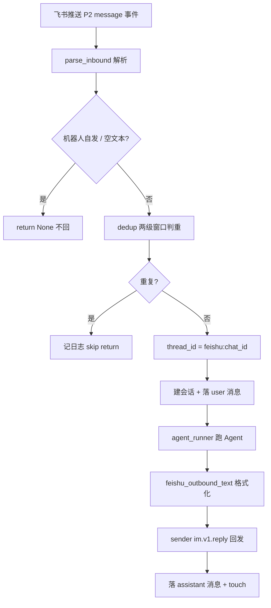

# channels/feishu.py —— 飞书 IM 渠道

> **文件路径**: `backend/app/channels/feishu.py`
> **目录位置**: channels → feishu.py
> **职责**: 飞书消息 → 去重 → 跑 Agent → 回发（M7 验收点 5：飞书发消息给机器人 → 收到 Agent 回复）

## 📋 基础信息

- **对标来源**: `evoflow/app/channels/feishu.py`（原版 3232 行）+ `feishu_message_format.py`（发消息文本格式化）
- **里程碑**: M7（IM 渠道，飞书先发）
- **连接模式**: 生产用 **lark-oapi WebSocket 长连接**（无需公网 IP）；同时提供 `handle_challenge` 兼容「事件订阅 Webhook 回调」模式的 URL 校验。
- **合规**: 仅用授权的飞书自建应用凭证，遵守飞书开放平台协议。
- **裁剪范围**: 原版是「WS 长连接 + 事件回调 + MessageBus + 流式卡片补丁 + 审批/评审卡片 + 多账号 + 表情反应」的大集成；M7 只搬核心链路：challenge 校验 → 入站解析 → 去重（msg_id 窗口 + 内容 hash 窗口）→ chat_id↔thread_id 映射 → 跑 Agent（可注入 runner）→ 回复文本格式化 → 回发。

## 🧩 模块结构图

```text
┌────────────────────────────────────────────────────────────────┐
│ _FeishuInboundDeduper   两级去重（msg_id 窗口 + 内容 hash 窗口）│
│ handle_challenge(body)  事件订阅 URL 校验 → {"challenge": ...} │
│ parse_inbound(event)    lark 事件对象 → ParsedInbound | None  │
│ feishu_outbound_text(t) 回复文本格式化（澄清 JSON→Markdown）   │
│                                                                │
│ FeishuChannel(Channel)                                        │
│   on_message(event)      ← lark P2 回调入口（收→去重→跑→回发）│
│   thread_id_for(chat_id)  chat_id ↔ LangGraph thread_id 映射   │
│   start()/stop()          生命周期（生产用 serve()）            │
│                                                                │
│ serve(app_id, app_secret)  渠道独立运行入口（装配 Agent + WS）   │
└────────────────────────────────────────────────────────────────┘
```

## 💡 设计思想

1. **依赖注入解耦测试**：`agent_runner` / `sender` / `session_repo` 全部注入。生产由 `serve()` 装配真实 `make_lead_agent` + lark 回发客户端；单测注入 fake runner + 列表式 sender + 内存 SQLite，全程离线、不真调模型。
2. **延迟 import lark_oapi**：模块顶层不 import SDK（测试 import 本模块不依赖 lark）；`serve()` 内才 import，与原版 `start()` 内 import 一致。
3. **去重两级窗口**：① `msg_id` 在 `id_ttl`(120s) 内只处理一次（防 WS 重连重投）；② 同 chat + 归一化正文在 `content_ttl`(20s) 内只处理一次（兜住带新 `msg_id` 的罕见重投）。对齐原版 `_FeishuInboundDeduper`。
4. **chat_id ↔ thread_id**：同一飞书会话稳定映射成 `feishu:<chat_id>` 这一个 LangGraph thread，checkpointer 据此恢复多轮上下文。

## 📤 对外导出

**函数 / 类**
- `FeishuChannel`：飞书渠道（`on_message` 回调 + 注入式装配）
- `handle_challenge(body)`：事件订阅 URL 校验，命中返回 `{"challenge": ...}`
- `parse_inbound(event)`：lark 事件 → `ParsedInbound | None`
- `feishu_outbound_text(text)`：回复文本格式化
- `serve(*, app_id, app_secret)`：渠道独立运行入口

**内部私有**
- `_FeishuInboundDeduper`：入站去重（msg_id / 内容两级窗口）
- `_extract_text` / `_is_bot_sender` / `_get`：事件解析辅助
- `ParsedInbound`：解析结果 dataclass

## 🎯 目标

- 验收点 5：飞书里 @机器人 / 私聊发消息 → 收到 Agent 回复。
- 渠道**独立运行**（不挂 gateway app）：`serve()` 进程即一个飞书渠道服务。
- 全部核心逻辑可离线单测（`tests/test_channel_feishu.py`，20 用例）。

## 📊 流程图（顺序执行链）

**生产长连接链（`serve`）：**

```text
serve(app_id, app_secret)
│
▼
load_config(PROJECT_ROOT/config.yaml)            ← 读模型配置（与 CLI 同源）
│
▼
init_db(db_path) + create_sqlite_checkpointer    ← 建表 + 图状态落盘
│
▼
create_chat_model(cfg.models.chat)               ← 模型工厂（OpenAI 兼容）
│
▼
make_lead_agent(model, checkpointer, [], [])     ← 编译主 Agent
│
▼
定义 agent_runner(thread_id, text)               ← agent.invoke → 取最后一条 AIMessage.content
│
▼
lark.Client.builder().app_id/secret().build()    ← 真实回发客户端
│
▼
定义 sender(chat_id, reply_to, text)             ← im.v1.message.reply
│
▼
EventDispatcherHandler.register_p2_im_message_receive_v1(channel.on_message).build()
│
▼
lark.ws.Client(...).start()                      ← 阻塞：长连接等飞书推消息
```

**单条消息入站链（`on_message`，每步右侧注释）：**

```text
飞书推送一条 P2 im.message.receive_v1 事件
│
▼
parse_inbound(event)                             ← 取 event.event.message.*
│   ├─ _is_bot_sender(event) → True ?            ← 机器人自发/别机器人 echo → return None（不回）
│   ├─ chat_id / msg_id / root_id / content      ← _get 兼容 SDK 对象与 dict
│   ├─ _extract_text(content)                     ← 解析 JSON：纯文本 text / 富文本 post
│   ├─ strip BOM/零宽字符；空文本 → return None
│   └─ reply_to = root_id if root_id≠msg_id else msg_id   ← 楼中楼必须回 root_id（否则 230002）
▼
dedup.is_duplicate(msg_id, chat_id, text)       ← 两级窗口
│   ├─ msg_id 在 id_ttl(120s) 窗口见过 ? → True → 记日志 skip，return
│   └─ 同 chat+归一化正文在 content_ttl(20s) 见过 ? → True → return
▼
thread_id = "feishu:" + chat_id                  ← 稳定映射到 LangGraph thread
│
▼
session_repo.create(thread_id) + add_message(user)← 建会话(幂等) + 落用户消息
│
▼
reply = agent_runner(thread_id, text)           ← 跑 Agent（异常→兜底文案）
│
▼
reply = feishu_outbound_text(reply)              ← 澄清 JSON→Markdown；空→兜底
│
▼
sender(chat_id, reply_to, reply)                 ← im.v1.message.reply（异常→记日志 return）
│
▼
session_repo.add_message(assistant) + touch       ← 落回复 + 刷新会话时间
```

**Mermaid 版（GitHub / 飞书渲染）：**



## ❓ Q&A / 知识点

### 1. 为什么要两级去重？只用 message_id 不够吗？

**一句话**：飞书 WebSocket 在重连 / 网络抖动时会**重投**同一批事件（带相同 message_id），id 窗口兜得住；但极少数情况下重投会带着**新的 message_id**到达——这时 id 窗口失效，就得靠「同 chat + 归一化正文」的内容 hash 窗口再挡一次。对齐原版 `_FeishuInboundDeduper` 的双保险。

### 2. 去重会不会吞掉用户正常连发的两条相同消息？

**一句话**：会，但只在 20 秒内容窗口内、同一 chat、一字不差（含折叠空白、去 `@_user_N`）时才吞。这是刻意取舍——窗口短，正常打字连发两条相同句子概率极低，换来的是不重复回复、不重复调模型。**不要把 `content_ttl` 调大**。

### 3. `chat_id` 怎么映射成 `thread_id`？为什么固定这么映射？

**一句话**：`thread_id = "feishu:" + chat_id`。同一飞书会话（群/私聊）永远落到同一个 LangGraph thread，checkpointer 才能在多次消息间恢复多轮上下文。映射是**确定性**的（不另存映射表），重启进程也能续上同一个 thread。

### 4. 楼中楼（话题回复）为什么必须用 root_id 回复？

**一句话**：飞书 `im.v1.message.reply` 在楼中楼场景下，如果拿叶子消息 id 去 reply，会报 `230002`。原版实测踩过这个坑——所以解析时 `root_id ≠ msg_id` 就把 `reply_to` 换成 `root_id`。

### 5. 为什么测试能完全离线、不真调模型？

**一句话**：`FeishuChannel` 构造时注入 `agent_runner` 和 `sender`。测试传 fake runner（返回固定串）+ 列表式 sender（记录发出内容）+ 内存 SQLite 的 `SessionRepository`，全程不连网、不加载 lark SDK、不调模型 API。`serve()` 才是真实装配。

### 6. WebSocket 长连接 vs 事件订阅 Webhook，为什么选 WS？

**一句话**：WS 长连接**不需要公网 IP / 回调域名**，本地开发、内网机器都能直接收消息；Webhook 回调需要一个能被飞书访问到的公网 URL。M7 演示环境优先选 WS。`handle_challenge` 保留是为了兼容/过渡到 Webhook 模式时的 URL 校验。

## ⚠️ 风险点

1. **lark 事件属性路径勿写死成 dict**——真实 SDK 用对象、测试用 `SimpleNamespace`，`_get` 同时兼容 `getattr` / `dict[key]`；改解析逻辑时两种形态都要测。
2. **sender 抛错只记日志不崩进程**——lark 回调线程不能因单次回发失败退出（`try/except` 包住）。
3. **`reply_to` 楼中楼必须用 root_id**——否则飞书报 `230002`；改回复锚点逻辑前先确认。
4. **去重窗口内相同消息会被吞**——这是刻意取舍，勿把 `content_ttl` 调大。
5. **`serve()` 才真实装配模型/客户端**——单测走注入式构造；不要在测试里直接调 `serve()`（会连飞书）。
