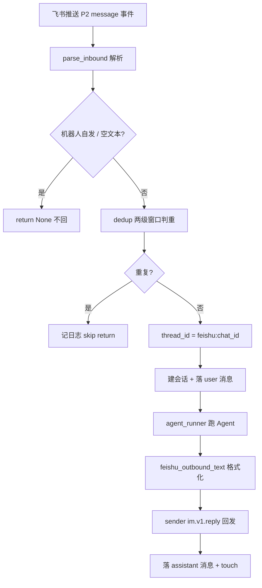

# channels/feishu.py —— 飞书 IM 渠道

> **文件路径**: `backend/app/channels/feishu.py`
> **目录位置**: channels → feishu.py
> **职责**: 飞书消息 → 去重 → 跑 Agent → 回发（M7 验收点 5：飞书发消息给机器人 → 收到 Agent 回复）

## 📋 基础信息

- **对标来源**: `evoflow/app/channels/feishu.py`（原版 3232 行）+ `feishu_message_format.py`（发消息文本格式化）
- **里程碑**: M7（IM 渠道，飞书先发）
- **连接模式**: 生产用 **lark-oapi WebSocket 长连接**（无需公网 IP）；同时提供 `handle_challenge` 兼容「事件订阅 Webhook 回调」模式的 URL 校验。
- **合规**: 仅用授权的飞书自建应用凭证，遵守飞书开放平台协议。
- **裁剪范围**: 原版是「WS 长连接 + 事件回调 + MessageBus + 流式卡片补丁 + 审批/评审卡片 + 多账号 + 表情反应」的大集成；M7 只搬核心链路：challenge 校验 → 入站解析 → 去重（msg_id 窗口 + 内容 hash 窗口）→ chat_id↔thread_id 映射 → 跑 Agent（可注入 runner）→ 回复文本格式化 → 回发。

## 🧩 模块结构图

```text
┌────────────────────────────────────────────────────────────────┐
│ _FeishuInboundDeduper   两级去重（msg_id 窗口 + 内容 hash 窗口）│
│ handle_challenge(body)  事件订阅 URL 校验 → {"challenge": ...} │
│ parse_inbound(event)    lark 事件对象 → ParsedInbound | None  │
│ feishu_outbound_text(t) 回复文本格式化（澄清 JSON→Markdown）   │
│                                                                │
│ FeishuChannel(Channel)                                        │
│   on_message(event)      ← lark P2 回调入口（收→去重→跑→回发）│
│   thread_id_for(chat_id)  chat_id ↔ LangGraph thread_id 映射   │
│   start()/stop()          生命周期（生产用 serve()）            │
│                                                                │
│ serve(app_id, app_secret)  渠道独立运行入口（装配 Agent + WS）   │
└────────────────────────────────────────────────────────────────┘
```

## 💡 设计思想

1. **依赖注入解耦测试**：`agent_runner` / `sender` / `session_repo` 全部注入。生产由 `serve()` 装配真实 `make_lead_agent` + lark 回发客户端；单测注入 fake runner + 列表式 sender + 内存 SQLite，全程离线、不真调模型。
2. **延迟 import lark_oapi**：模块顶层不 import SDK（测试 import 本模块不依赖 lark）；`serve()` 内才 import，与原版 `start()` 内 import 一致。
3. **去重两级窗口**：① `msg_id` 在 `id_ttl`(120s) 内只处理一次（防 WS 重连重投）；② 同 chat + 归一化正文在 `content_ttl`(20s) 内只处理一次（兜住带新 `msg_id` 的罕见重投）。对齐原版 `_FeishuInboundDeduper`。
4. **chat_id ↔ thread_id**：同一飞书会话稳定映射成 `feishu:<chat_id>` 这一个 LangGraph thread，checkpointer 据此恢复多轮上下文。

## 📤 对外导出

**函数 / 类**
- `FeishuChannel`：飞书渠道（`on_message` 回调 + 注入式装配）
- `handle_challenge(body)`：事件订阅 URL 校验，命中返回 `{"challenge": ...}`
- `parse_inbound(event)`：lark 事件 → `ParsedInbound | None`
- `feishu_outbound_text(text)`：回复文本格式化
- `serve(*, app_id, app_secret)`：渠道独立运行入口

**内部私有**
- `_FeishuInboundDeduper`：入站去重（msg_id / 内容两级窗口）
- `_extract_text` / `_is_bot_sender` / `_get`：事件解析辅助
- `ParsedInbound`：解析结果 dataclass

## 🎯 目标

- 验收点 5：飞书里 @机器人 / 私聊发消息 → 收到 Agent 回复。
- 渠道**独立运行**（不挂 gateway app）：`serve()` 进程即一个飞书渠道服务。
- 全部核心逻辑可离线单测（`tests/test_channel_feishu.py`，20 用例）。

## 📊 流程图（顺序执行链）

**生产长连接链（`serve`）：**

```text
serve(app_id, app_secret)
│
▼
load_config(PROJECT_ROOT/config.yaml)            ← 读模型配置（与 CLI 同源）
│
▼
init_db(db_path) + create_sqlite_checkpointer    ← 建表 + 图状态落盘
│
▼
create_chat_model(cfg.models.chat)               ← 模型工厂（OpenAI 兼容）
│
▼
make_lead_agent(model, checkpointer, [], [])     ← 编译主 Agent
│
▼
定义 agent_runner(thread_id, text)               ← agent.invoke → 取最后一条 AIMessage.content
│
▼
lark.Client.builder().app_id/secret().build()    ← 真实回发客户端
│
▼
定义 sender(chat_id, reply_to, text)             ← im.v1.message.reply
│
▼
EventDispatcherHandler.register_p2_im_message_receive_v1(channel.on_message).build()
│
▼
lark.ws.Client(...).start()                      ← 阻塞：长连接等飞书推消息
```

**单条消息入站链（`on_message`，每步右侧注释）：**

```text
飞书推送一条 P2 im.message.receive_v1 事件
│
▼
parse_inbound(event)                             ← 取 event.event.message.*
│   ├─ _is_bot_sender(event) → True ?            ← 机器人自发/别机器人 echo → return None（不回）
│   ├─ chat_id / msg_id / root_id / content      ← _get 兼容 SDK 对象与 dict
│   ├─ _extract_text(content)                     ← 解析 JSON：纯文本 text / 富文本 post
│   ├─ strip BOM/零宽字符；空文本 → return None
│   └─ reply_to = root_id if root_id≠msg_id else msg_id   ← 楼中楼必须回 root_id（否则 230002）
▼
dedup.is_duplicate(msg_id, chat_id, text)       ← 两级窗口
│   ├─ msg_id 在 id_ttl(120s) 窗口见过 ? → True → 记日志 skip，return
│   └─ 同 chat+归一化正文在 content_ttl(20s) 见过 ? → True → return
▼
thread_id = "feishu:" + chat_id                  ← 稳定映射到 LangGraph thread
│
▼
session_repo.create(thread_id) + add_message(user)← 建会话(幂等) + 落用户消息
│
▼
reply = agent_runner(thread_id, text)           ← 跑 Agent（异常→兜底文案）
│
▼
reply = feishu_outbound_text(reply)              ← 澄清 JSON→Markdown；空→兜底
│
▼
sender(chat_id, reply_to, reply)                 ← im.v1.message.reply（异常→记日志 return）
│
▼
session_repo.add_message(assistant) + touch       ← 落回复 + 刷新会话时间
```

**Mermaid 版（GitHub / 飞书渲染）：**



## 🧩 代码解析（成块对照 feishu.py）

### 块 1：`_FeishuInboundDeduper.is_duplicate` —— 两级去重窗口

```python
def is_duplicate(self, *, msg_id: str, chat_id: str, text: str) -> bool:
    now = time.time()
    self._cleanup(self._by_msg_id, now, self._id_ttl)
    self._cleanup(self._by_content, now, self._content_ttl)

    mid = str(msg_id or "").strip()
    if mid:
        if mid in self._by_msg_id:
            return True
        self._by_msg_id[mid] = now

    # 归一化正文：折叠空白、去掉 @_user_N 占位
    body = re.sub(r"\s+", " ", str(text or "").strip())
    body = re.sub(r"@_user_\d+\s*", "", body).strip()
    if body:
        content_key = f"{chat_id}:{hashlib.sha1(body.encode('utf-8')).hexdigest()[:16]}"
        if content_key in self._by_content:
            return True
        self._by_content[content_key] = now
    return False
```

**关键点**：

- **先清理过期再判重**：每进来一条先 `_cleanup` 掉超 TTL 的旧键（`now - ttl` 之前的 pop）——窗口是"滑动窗口"，不是"定时清"；dict 无限增长被这个前置清理拦住。
- **两级判重是"或"关系，不是"与"**：id 窗口命中 → True；id 窗口未命中 → 继续查内容窗口。两条独立防线：id 防"同消息重投"，内容防"换新 id 的重投"。
- **内容归一化 `re.sub(r"@_user_\d+\s*", "", body)`**：飞书把 @某人 渲染成 `@_user_1` 这类占位符——同一句话"@A 说"和"@B 说"归一化后相同？不，`@_user_1` 被剥掉后 `body` 只剩"说"——**这会让 @不同人的相同文本被判重**。这是刻意取舍（对齐原版），窗口只有 20s，可接受。
- **内容 key = `chat_id:sha1(body)[:16]`**：加 chat_id 前缀（不同会话的相同消息不算重）+ 16 位 hash（碰撞概率极低，比存全文省内存）。

### 块 2：`_get` / `_extract_text` / `parse_inbound` —— 事件解析与双形态兼容

```python
def _get(obj: Any, path: tuple[str, ...], default: Any = None) -> Any:
    """按属性路径取值，每段既支持 getattr（SDK 对象）也支持 dict[key]。"""
    cur = obj
    for part in path:
        if cur is None:
            return default
        cur = cur.get(part) if isinstance(cur, dict) else getattr(cur, part, None)
    return cur if cur is not None else default

def _extract_text(content_raw: Any) -> str:
    """从 message.content（JSON 字符串）解析出纯文本（含富文本 post）。"""
    if not content_raw:
        return ""
    if isinstance(content_raw, dict):
        content = content_raw
    else:
        try:
            content = json.loads(str(content_raw))
        except (json.JSONDecodeError, TypeError, ValueError):
            return str(content_raw).strip()
    ...
    # 纯文本消息：content 里有 "text" 字段
    if "text" in content:
        return str(content["text"])
    # 富文本 post：content 是 [[{tag:text/at, text:...}, ...], ...]
    inner = content.get("content")
    if isinstance(inner, list):
        paragraphs = [...]
        for para in inner:
            if isinstance(para, list):
                parts = [el.get("text", "") for el in para
                         if isinstance(el, dict) and el.get("tag") in ("text", "at") and el.get("text")]
                if parts:
                    paragraphs.append(" ".join(parts))
        return "\n\n".join(paragraphs)
    return ""
```

**关键点**：

- **`_get` 双形态兼容**：飞书 SDK 事件是对象（`event.event.message.message_id`），测试用 `SimpleNamespace`（也是 getattr），但也可能有人传 dict——`_get` 每段判断 `isinstance(cur, dict)`，**SDK 对象 / dict / 测试桩三种形态统一访问**。这是"测试能离线"的根基之一。
- **`_extract_text` 两种消息形态**：飞书 `message.content` 是 JSON 字符串：纯文本消息 `{"text":"你好"}`；富文本 post 消息 `{"content":[[{tag:"text",text:"你好"},{tag:"at",...}],...]}`。解析失败（非 JSON）时**原样返回字符串**（兜底，至少不丢内容）。
- **富文本只取 `tag in ("text","at")`**：图片/表情等非文本元素被过滤——Agent 只拿文字（图片等 M7 不处理）。

### 块 3：`FeishuChannel.on_message` —— 主链路（收 → 去重 → 跑 → 回发 → 落库）

```python
def on_message(self, event: Any) -> None:
    parsed = parse_inbound(event)
    if parsed is None:
        return
    if self.dedup.is_duplicate(msg_id=parsed.msg_id, chat_id=parsed.chat_id, text=parsed.text):
        logger.info("[Feishu] skip duplicate inbound: ...")
        return
    thread_id = self.thread_id_for(parsed.chat_id)
    if self.session_repo is not None:
        self.session_repo.create(thread_id)
        self.session_repo.add_message(thread_id, "user", parsed.text)
    try:
        reply = self.agent_runner(thread_id, parsed.text)
    except Exception:
        logger.exception("[Feishu] agent run failed: chat=%s", parsed.chat_id)
        reply = "(Agent 调用失败，请稍后再试)"
    reply = feishu_outbound_text(reply or "")
    if not reply.strip():
        reply = _EMPTY_REPLY
    try:
        self.sender(parsed.chat_id, parsed.reply_to, reply)
    except Exception:
        logger.exception("[Feishu] send reply failed: chat=%s", parsed.chat_id)
        return
    if self.session_repo is not None:
        self.session_repo.add_message(thread_id, "assistant", reply)
        self.session_repo.touch(thread_id)
```

**关键点**：

- **整条链路三个 try/except 分界**：agent 失败 → 兜底文案继续发（用户至少收到"稍后再试"）；sender 失败 → 记日志 return（**不回发但已落库 user 消息**，会话记录仍完整）；其余解析/去重失败 → 直接 return（不打断 lark 回调线程）。
- **`session_repo` 可空**：`if self.session_repo is not None`——测试不注入 repo 也能跑（只测链路语义）；生产注入真实 repo 落库。
- **`_EMPTY_REPLY = "（空回复）"`**：飞书不允许发空文本消息，Agent 返回空串时兜底。
- **落 assistant 消息 + `touch`**：回复发出后更新会话（消息落库 + 刷新 updated_at），与 gateway 的 `sessions` 表共用——**CLI/网关/飞书三入口看到的会话历史一致**。

### 块 4：`feishu_outbound_text` —— 澄清 JSON → Markdown

```python
def feishu_outbound_text(text: str) -> str:
    raw = text or ""
    s = raw.strip()
    if len(s) < 2 or s[0] != "{":
        return raw                      # 不是 JSON 样子 → 原样返回
    try:
        obj = json.loads(s)
    except (json.JSONDecodeError, TypeError, ValueError):
        return raw
    if not isinstance(obj, dict):
        return raw
    if not (set(obj) & {"question", "questions", "options", "title", "context"}):
        return raw                      # 启发式：不像澄清 schema → 原样
    lines = ["❔ **需要您确认**", ""]
    ...
    body = "\n".join(lines).strip()
    return body or raw
```

**关键点**：

- **三道"不像就别动"护栏**：① 开头不是 `{` → 原样；② 不是合法 JSON dict → 原样；③ 键集合与澄清 schema 无交集 → 原样。**普通对话文本永不被动**，只有"长得像 ask_clarification 输出"的 JSON 才转 Markdown。
- **启发式键匹配**：`question/questions/options/title/context` 是澄清 schema 的特征键——用 `set(obj) & {...}` 判断交集，不要求全键匹配（容错字段缺失）。
- 这是**可逆的安全转换**：误判只会把普通文本原样返回（护栏 1/2 挡掉绝大多数），不会把用户消息改写。

### 块 5：`serve` —— 生产装配（延迟 import + 独立运行）

```python
def serve(*, app_id: str, app_secret: str) -> None:
    import lark_oapi as lark                      # 延迟 import：顶层不依赖 SDK
    from agentflow.agents.checkpointer.provider import create_sqlite_checkpointer
    from agentflow.agents.lead_agent.agent import make_lead_agent
    ...
    cfg = load_config(str(PROJECT_ROOT / "config.yaml"))
    db_path = default_db_path()
    init_db(db_path)
    checkpointer = create_sqlite_checkpointer(db_path)
    model = create_chat_model(cfg.models.chat)
    agent = make_lead_agent(model=model, checkpointer=checkpointer, tools=[], middlewares=[])

    def agent_runner(thread_id, text) -> str:     # 同步 invoke → 最后一条 AI 文本
        resp = agent.invoke({"messages": [HumanMessage(text)]},
                            config={"configurable": {"thread_id": thread_id}})
        msgs = resp.get("messages") if isinstance(resp, dict) else getattr(resp, "messages", [])
        return str(msgs[-1].content) if msgs else ""

    client = lark.Client.builder().app_id(app_id).app_secret(app_secret).build()
    def sender(chat_id, reply_to, text) -> None:
        request = (lark.im.v1.ReplyMessageRequest.builder().message_id(reply_to)
                   .request_body(lark.im.v1.ReplyMessageRequestBody.builder()
                                 .msg_type("text").content(json.dumps({"text": text})).build()).build())
        client.im.v1.message.reply(request)

    channel = FeishuChannel(agent_runner=agent_runner, sender=sender, session_repo=sessions)
    event_handler = (lark.EventDispatcherHandler.builder("", "")
                     .register_p2_im_message_receive_v1(channel.on_message).build())
    ws_client = lark.ws.Client(app_id=app_id, app_secret=app_secret,
                               event_handler=event_handler, log_level=lark.LogLevel.INFO)
    channel._running = True
    ws_client.start()  # 阻塞
```

**关键点**：

- **`serve()` 内全部延迟 import**：模块顶层只 import `app.channels.base`——测试 `import feishu` 不需要 lark/agent 栈。`serve()` 是"重装配"，只在真要跑渠道时执行。
- **装配与 CLI 同源**：`load_config → init_db → create_sqlite_checkpointer → create_chat_model → make_lead_agent`——与 `cli/main.py` 同一套配置/存储/模型工厂，**不是另造一套**。裁剪掉工具/中间件/记忆（M7 渠道最小集）。
- **`agent_runner` 同步 invoke + 取最后一条 AI 文本**：与 gateway `_build_default_runner` 同款 `msgs[-1].content` 逻辑（`_ai_text` 模式）——三条入口（CLI/gateway/飞书）取回复的方式完全一致。
- **`ws_client.start()` 阻塞主线程**：渠道是独立进程（`python -m app.channels.feishu` 或类似入口），不挂 gateway app——M7 验收点 5 的"独立运行"。
- **`on_message` 跑在 lark 回调线程**（同步）：`start()` 抛 `NotImplementedError` 引导用 `serve()`——防止误用抽象方法启动。

## ❓ Q&A / 知识点

### 1. 为什么要两级去重？只用 message_id 不够吗？

**一句话**：飞书 WebSocket 在重连 / 网络抖动时会**重投**同一批事件（带相同 message_id），id 窗口兜得住；但极少数情况下重投会带着**新的 message_id**到达——这时 id 窗口失效，就得靠「同 chat + 归一化正文」的内容 hash 窗口再挡一次。对齐原版 `_FeishuInboundDeduper` 的双保险。

### 2. 去重会不会吞掉用户正常连发的两条相同消息？

**一句话**：会，但只在 20 秒内容窗口内、同一 chat、一字不差（含折叠空白、去 `@_user_N`）时才吞。这是刻意取舍——窗口短，正常打字连发两条相同句子概率极低，换来的是不重复回复、不重复调模型。**不要把 `content_ttl` 调大**。

### 3. `chat_id` 怎么映射成 `thread_id`？为什么固定这么映射？

**一句话**：`thread_id = "feishu:" + chat_id`。同一飞书会话（群/私聊）永远落到同一个 LangGraph thread，checkpointer 才能在多次消息间恢复多轮上下文。映射是**确定性**的（不另存映射表），重启进程也能续上同一个 thread。

### 4. 楼中楼（话题回复）为什么必须用 root_id 回复？

**一句话**：飞书 `im.v1.message.reply` 在楼中楼场景下，如果拿叶子消息 id 去 reply，会报 `230002`。原版实测踩过这个坑——所以解析时 `root_id ≠ msg_id` 就把 `reply_to` 换成 `root_id`。

### 5. 为什么测试能完全离线、不真调模型？

**一句话**：`FeishuChannel` 构造时注入 `agent_runner` 和 `sender`。测试传 fake runner（返回固定串）+ 列表式 sender（记录发出内容）+ 内存 SQLite 的 `SessionRepository`，全程不连网、不加载 lark SDK、不调模型 API。`serve()` 才是真实装配。

### 6. WebSocket 长连接 vs 事件订阅 Webhook，为什么选 WS？

**一句话**：WS 长连接**不需要公网 IP / 回调域名**，本地开发、内网机器都能直接收消息；Webhook 回调需要一个能被飞书访问到的公网 URL。M7 演示环境优先选 WS。`handle_challenge` 保留是为了兼容/过渡到 Webhook 模式时的 URL 校验。

## ⚠️ 风险点

1. **lark 事件属性路径勿写死成 dict**——真实 SDK 用对象、测试用 `SimpleNamespace`，`_get` 同时兼容 `getattr` / `dict[key]`；改解析逻辑时两种形态都要测。
2. **sender 抛错只记日志不崩进程**——lark 回调线程不能因单次回发失败退出（`try/except` 包住）。
3. **`reply_to` 楼中楼必须用 root_id**——否则飞书报 `230002`；改回复锚点逻辑前先确认。
4. **去重窗口内相同消息会被吞**——这是刻意取舍，勿把 `content_ttl` 调大。
5. **`serve()` 才真实装配模型/客户端**——单测走注入式构造；不要在测试里直接调 `serve()`（会连飞书）。

> 页脚：2026-10-13 · M7 IM 渠道 · 对齐 `evoflow/app/channels/feishu.py`（裁剪）
