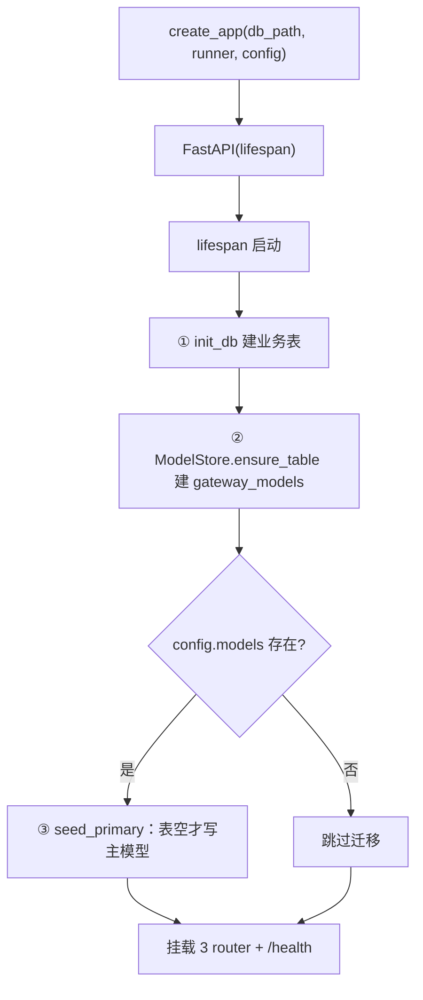

# gateway/app.py — app.py

> **文件路径**: `backend/app/gateway/app.py`
> **目录位置**: gateway → app.py
> **职责**: FastAPI 应用装配（create_app 工厂 + lifespan 初始化 + 挂 3 个 router）

## 📑 目录

- [📋 结构图 / 思维图](#📋-结构图--思维图)
- [📤 关键导出](#📤-关键导出)
- [💡 设计思想](#💡-设计思想)
- [🎯 实用场景](#🎯-实用场景)
- [🧩 顺序执行链](#🧩-顺序执行链)
- [❓ Q&A](#❓-qa)
- [⚠️ 风险点](#⚠️-风险点)

## 📋 结构图 / 思维图

**ASCII 版**：

```text
┌──────────────────────────────────────────────────────────────┐
│ create_app(db_path?, runner?, config?) → FastAPI              │
│   lifespan:                                                  │
│     ① init_db(db_path)            ← 复用 persistence.bootstrap│
│     ② ModelStore.ensure_table()   ← gateway_models 幂等建表 │
│     ③ config.models → seed_primary() ← yaml→SQLite 迁移(幂等) │
│   app.state: db_path/model_store/sessions/runs/runner        │
│   mount: models.runs.threads.router（前缀 /api）+ GET /health │
│                                                              │
│ create_default_app() → 加载 .env + config.yaml 后 create_app │
└──────────────────────────────────────────────────────────────┘
```

**Mermaid 版**：



## 📤 关键导出

**函数**

- `create_app(db_path, runner, config)` — 应用工厂（测试/生产共用）
- `create_default_app()` — 生产装配（uvicorn --factory 入口）

## 💡 设计思想

1. **工厂注入**：`create_app(db_path=tmp)` 让测试用临时库；`runner=fake` 让测试离线，不调真实模型。
2. **lifespan 一次性初始化**：建业务表（复用 bootstrap）+ gateway 模型表自建 + yaml 迁移，全部幂等。
3. **默认 runner 现场读主模型**：`_build_default_runner` 每次调用都 `get_primary()`，改 SQLite 不重启即切换。

## 🎯 实用场景

1. 本地起网关：`uvicorn agentflow.gateway.app:create_default_app --factory`
2. 测试接线：`create_app(db_path=tmp_path/"t.db", runner=fake)` 注入临时库 + fake 执行体
3. 生产迁移：启动时把 config.yaml 的 chat 配置种子进 SQLite（表空才写，不覆盖 API 建的模型）

## 🧩 顺序执行链

**请求 → 装配后的运行链**（以 `POST /api/runs` 为例，每步右侧注释）：

```text
request: POST /api/runs {message, thread_id?}
   ▼  路由匹配 runs.router（前缀 /api）
   ▼  create_run(request, body)                              ← 从 app.state 取 sessions/model_store
   ▼  sessions.create(thread_id)                            ← 幂等建会话（SQLite）
   ▼  sessions.add_message(thread_id,"user",message)         ← 业务明文消息落库
   ▼  app.state.runs[run_id] = {status:"pending", ...}      ← run 注册表（内存执行态）
   ▼  return 201 {run_id, thread_id, status:"pending"}
```

SSE 子链（`GET /api/runs/{id}/stream`）：`_stream_run` → `app.state.runner(thread_id, message)` 逐块产文本 → `delta_event` 推流 → `done_event` 收尾并回写 run 状态。

## ❓ Q&A

**Q: 为什么不在模块层建 `app = create_default_app()`？**
A: 那样测试 `import agentflow.gateway.app` 就会加载项目 config.yaml 并写默认库（副作用）。改成 uvicorn `--factory` 显式触发，测试按需 `create_app()`。

**Q: 默认 runner 为什么是缓冲式（invoke 完才出块）？**
A: M7 先保证链路通；逐 token 真流式后续在 `_build_default_runner` 用队列+线程增强，测试用 fake runner 已能验证"逐块推送"语义。

## ⚠️ 风险点

1. 不要在模块层执行 `create_default_app()`（测试 import 副作用）
2. uvicorn 入口必须用 `--factory`，否则拿不到加载配置后的 app
3. lifespan 迁移只在表空时种子——用户经 API 建的模型不会被 yaml 覆盖
