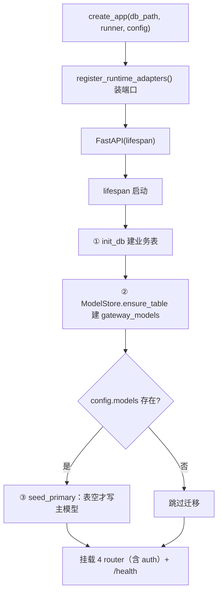

# gateway/app.py — app.py

> **文件路径**: `backend/app/gateway/app.py`
> **目录位置**: app → gateway → app.py
> **职责**: FastAPI 应用装配（create_app 工厂 + lifespan 初始化 + 挂 4 个 router：models/runs/threads + auth（M8 追加））

>agent lifespan  智能体的生命周期

## 📑 目录

- [📋 结构图 / 思维图](#📋-结构图--思维图)
- [📤 关键导出](#📤-关键导出)
- [💡 设计思想](#💡-设计思想)
- [🎯 实用场景](#🎯-实用场景)
- [🧩 顺序执行链](#🧩-顺序执行链)
- [🧩 代码解析（成块对照 app.py）](#🧩-代码解析成块对照-apppy)
- [❓ Q&A / 知识点](#❓-qa--知识点)
- [⚠️ 风险点](#⚠️-风险点)

## 📋 结构图 / 思维图

**ASCII 版**：

```text
┌──────────────────────────────────────────────────────────────┐
│ create_app(db_path?, runner?, config?) → FastAPI              │
│   0. register_runtime_adapters()   ← R1 端口装配（工厂开头）  │
│   lifespan:                                                  │
│     ① init_db(db_path)            ← 复用 persistence.bootstrap│
│     ② ModelStore.ensure_table()   ← gateway_models 幂等建表 │
│     ③ config.models → seed_primary() ← yaml→SQLite 迁移(幂等) │
│   app.state: db_path/model_store/sessions/runs/runner        │
│   mount: models.runs.threads.auth.router（前缀 /api）+ /health│
│   （auth 为 M8 追加；M7 时 3 个）                            │
│                                                              │
│ create_default_app() → 加载 .env + config.yaml 后 create_app │
└──────────────────────────────────────────────────────────────┘
```

**Mermaid 版**：



## 📤 关键导出

**函数**

- `create_app(db_path, runner, config)` — 应用工厂（测试/生产共用）
- `create_default_app()` — 生产装配（uvicorn --factory 入口）

## 💡 设计思想

1. **工厂注入**：`create_app(db_path=tmp)` 让测试用临时库；`runner=fake` 让测试离线，不调真实模型。
2. **lifespan 一次性初始化**：建业务表（复用 bootstrap）+ gateway 模型表自建 + yaml 迁移，全部幂等。
3. **默认 runner 现场读主模型**：`_build_default_runner` 每次调用都 `get_primary()`，改 SQLite 不重启即切换。

## 🎯 实用场景

1. 本地起网关：`uvicorn app.gateway.app:create_default_app --factory`
2. 测试接线：`create_app(db_path=tmp_path/"t.db", runner=fake)` 注入临时库 + fake 执行体
3. 生产迁移：启动时把 config.yaml 的 chat 配置种子进 SQLite（表空才写，不覆盖 API 建的模型）

## 🧩 顺序执行链

**请求 → 装配后的运行链**（以 `POST /api/runs` 为例，每步右侧注释）：

```text
request: POST /api/runs {message, thread_id?}
   ▼  路由匹配 runs.router（前缀 /api）
   ▼  create_run(request, body)                              ← 从 app.state 取 sessions/model_store
   ▼  sessions.create(thread_id)                            ← 幂等建会话（SQLite）
   ▼  sessions.add_message(thread_id,"user",message)         ← 业务明文消息落库
   ▼  app.state.runs[run_id] = {status:"pending", ...}      ← run 注册表（内存执行态）
   ▼  return 201 {run_id, thread_id, status:"pending"}
```

SSE 子链（`GET /api/runs/{id}/stream`）：`_stream_run` → `app.state.runner(thread_id, message)` 逐块产文本 → `delta_event` 推流 → `done_event` 收尾并回写 run 状态。

**装配链（进程启动 → 服务就绪）**：

```text
uvicorn --factory app.gateway.app:create_default_app
   ▼  create_default_app()
   ▼  load_dotenv(PROJECT_ROOT/.env)                        ← 环境变量（失败仅 debug 日志）
   ▼  load_config(config.yaml) → AppConfig                  ← 全局配置唯一入口
   ▼  create_app(config=cfg)
   ▼  register_runtime_adapters()                           ← ① R1 端口装配（幂等）
   ▼  FastAPI(lifespan=lifespan, docs_url=/docs)
   ▼  app.state 装配: model_store/sessions/runs/runner      ← ② 依赖注入落点
   ▼  include_router × 4（models/runs/threads/auth）           ← ③ 挂 API（auth 为 M8 追加）
   ▼  lifespan 触发:
   ▼  init_db → ensure_table → seed_primary                 ← ④ 三初始化（幂等）
   ▼  GET /health → {"status":"ok"}                         ← 服务就绪
```

### 🔬 流程剖析（三链的关系与设计意图）

**1. 三条链的层次关系**

```
装配链（进程启动，只跑一次）
   │  产出 app.state（依赖注入落点）
   ▼
请求链（POST /api/runs，每请求一次）
   │  产出 run_id + 落库会话/消息
   ▼
SSE 子链（GET /stream，请求后异步消费）
   │  消费装配链注入的 runner，回写 run 状态
```

核心洞察：**SSE 子链不是独立第三条链，而是"请求链 → 执行体"的延续**——它读的 `run["thread_id"]/run["message"]` 来自请求链的产物，它用的 `runner` 来自装配链的注入。

**2. 装配链逐步剖析（为什么是这个顺序）**

| 步骤 | 职责 | 关键点 |
|---|---|---|
| `load_dotenv` | 环境变量（API key 等） | 失败仅 debug 日志——配置缺了由后续步骤诚实报错 |
| `load_config` → AppConfig | 全局配置唯一入口 | 类型化对象，config.yaml 只在这读一次 |
| `register_runtime_adapters()` ① | R1 端口装配 | 幂等；必须在挂路由**前**——路由处理时核心域可能就要用端口 |
| `app.state` 装配 ② | **依赖注入落点** | 全链枢纽：`model_store/sessions/runs/runner` 全挂 state——路由层不自己 new 依赖，只从 state 取 |
| `include_router × 4` ③ | 挂 API | 在 state 装配之后——路由处理函数要能取到 state（models/runs/threads + auth（M8 追加）） |
| lifespan 三初始化 ④ | `init_db → ensure_table → seed_primary` | 全幂等：建库建表 + 种子主模型（yaml→SQLite 迁移） |
| `GET /health` | 就绪信号 | 装配完成后才"可服务" |

顺序逻辑一句话：**先有环境/配置 → 再装端口 → 再挂依赖 → 再挂路由 → 最后初始化数据**。任何一步提前，后面的步骤取不到东西。

**3. 请求链逐步剖析（两种存储的分工）**

| 步骤 | 写入哪里 | 性质 |
|---|---|---|
| `sessions.create(thread_id)` | **SQLite** | 幂等建会话——重复 POST 不重复建 |
| `sessions.add_message(...)` | **SQLite** | 业务明文消息落库（持久，重启不丢） |
| `app.state.runs[run_id] = {...}` | **内存 dict** | run 执行态（pending→running→success），**进程内临时**——重启即丢 |

刻意的**持久化 vs 执行态分离**：会话/消息是"业务数据"进 SQLite；run 是"本次进程的执行记录"放内存（run 状态机是进程内生命周期，不是跨重启的）。

**4. SSE 子链剖析**

```
_stream_run(run)
  → async for chunk in app.state.runner(thread_id, message)   ← 执行体逐块产文本
  → yield delta_event(chunk)                                  ← 每块推流
  → 结束 → yield done_event(full)                             ← 收尾
  → 回写 run 状态（内存 runs[run_id] → success/failed）        ← 状态闭环
```

`runner` 是装配链注入的执行体（`async(thread_id, message) -> AsyncIterator[str]`）——默认是"真 agent + 线程池 invoke"（缓冲式，产一块）；测试注入 fake 则离线。

**5. 测试视角（这条链怎么被"换零件"）**

这正是装配链设计的目的——**测试在装配层替换，不改路由层**：

```python
create_app(db_path=tmp, runner=fake_runner, config=None)
```

- `db_path=tmp` → SQLite 落临时库（不污染真数据）
- `runner=fake_runner` → 装配链 ② 注入假执行体，请求链/SSE 子链**一行代码不改**就全离线（fake 逐块 yield 固定文本，前端照常收到 SSE）
- `config=None` → 跳过 yaml→SQLite 迁移（测试用空库起步）
- 端口装配 `register_runtime_adapters` 幂等 → 反复 create_app 只装一次

**顺序执行链的本质**：一条装配链把可替换的零件（DB/模型/runner/端口）全部装进 `app.state`，请求链和 SSE 子链只负责"从 state 取零件干活"——**测试 = 换装配层的零件，业务代码不动**。这也是后端 172 个测试全离线跑、不碰真实模型的原理（2026-10-18 实测）。

## 🧩 代码解析（成块对照 app.py）

### 块 1：imports + 端口装配钩子

```python
from agentflow.config.app_config import AppConfig, load_config
from agentflow.config.model_config import ModelConfig  # noqa: F401  (类型标注用)
from agentflow.config.paths import PROJECT_ROOT, default_db_path
from agentflow.persistence.bootstrap import init_db
from agentflow.persistence.session_repositories import SessionRepository
from fastapi import FastAPI

from app.gateway.model_store import ModelStore
from app.gateway.routers import auth as auth_router  # M8 追加：POST /api/auth/login
from app.gateway.routers import models as models_router
from app.gateway.routers import runs as runs_router
from app.gateway.routers import threads as threads_router
```

- **`app.*` 是 backend 顶层应用层**（严格对齐原版 `EvoFlow/backend/app/`）：核心层（`agentflow.*`）反向 import 应用层在 R1 里是禁止的，方向只允许 `app → agentflow`（见块 3 的 `_build_default_runner`）。
- `ModelConfig` 带 `noqa: F401`：只用于类型标注（`seed_primary(cfg: ChatModelConfig)`），运行时不需要。

### 块 2：`_build_default_runner` —— 真 agent 执行体（每次现场读主模型）

```python
def _build_default_runner(db_path: str, model_store: ModelStore):
    async def runner(thread_id: str, message: str) -> AsyncIterator[str]:
        import anyio
        from agentflow.agents.checkpointer.provider import create_sqlite_checkpointer
        from agentflow.agents.lead_agent.agent import make_lead_agent
        from agentflow.models.factory import create_chat_model
        from langchain_core.messages import HumanMessage

        row = model_store.get_primary()
        if row is None:
            raise RuntimeError("未配置任何模型，请先 POST /api/models 添加")
        cfg = ModelStore.to_chat_config(row)
        model = create_chat_model(cfg)
        checkpointer = create_sqlite_checkpointer(db_path)
        agent = make_lead_agent(
            model=model, checkpointer=checkpointer, tools=[], middlewares=[]
        )

        def _invoke() -> str:
            resp = agent.invoke(
                {"messages": [HumanMessage(content=message)]},
                config={"configurable": {"thread_id": thread_id}},
            )
            msgs = (
                resp.get("messages")
                if isinstance(resp, dict)
                else getattr(resp, "messages", [])
            )
            return msgs[-1].content if msgs else ""

        text = await anyio.to_thread.run_sync(
            _invoke
        )  # 同步 invoke 扔线程池，不阻塞事件循环
        yield text

    return runner
```

**关键点**：

- **函数内延迟 import 一切**（`anyio`/`lead_agent`/`factory`/`langchain`）：`create_app` 被测试 import 时不拉进整个 agent 栈，测试注入 fake runner 时这些 import 根本不执行。
- **`get_primary()` 现场读取**：模型配置存 SQLite，这里每次 run 都重新查主模型——**改配置不重启进程即生效**（M7 验收点 4 的实现核心）。
- **`anyio.to_thread.run_sync(_invoke)`**：`agent.invoke` 是同步阻塞调用（LangGraph 同步 API），直接放在 async 函数里会卡死 FastAPI 事件循环；扔线程池跑，事件循环保持响应。这就是"缓冲式"——整段回复一次取回再 yield，不是逐 token。
- 返回 `AsyncIterator[str]`（`yield text` 一次产一个完整块）：与 SSE 路由 `async for chunk in runner(...)` 的消费方式对齐。

**`yield` 详解（为什么 runner 是异步生成器）**：

`yield` 是生成器的"暂停/交出"关键字。对比：

```python
def f():
    return "x"     # 函数到此结束，调用方拿到 "x"，函数死了

def g():
    yield "x"      # 交出一个值，函数"活着"（暂停）
    yield "y"      # 下次要值，从这里继续，再交一个
```

- `return`：结束 + 给一个值（函数生命周期终止）
- `yield`：**中途交出值 + 保持可恢复**（函数变成生成器）

本函数因含 `yield` 而成为**异步生成器**，调用方式完全不同：

```python
it = runner(tid, msg)        # 调用只得到异步迭代器，函数体一行都没跑
async for chunk in it:       # 真正开始执行：跑函数体 → yield text
    ...                      # 拿到 text，暂停；下次循环发现已结束
```

真实行为：

```text
第 1 次要值 → 函数体从头跑 → 装配 agent → invoke → 到 yield text → 交出一整段 → 暂停
第 2 次要值 → 后面没代码 → 迭代器耗尽 → async for 循环结束
```

**为什么这里只有一个 yield（缓冲式）**：正常流式会多次 yield（逐 token/逐句交）；但 `invoke` 一次性拿回整段，所以只 yield 一次就结束。迭代器给消费端（SSE 路由）的"逐块接口"没变，只是"块数 = 1"——将来换成 `astream` 逐 token yield 时，`async for chunk` 消费代码不用改。

### 块 3：`create_app` —— 工厂核心（端口装配 + lifespan + state + router）

```python
def create_app(db_path=None, runner=None, config=None) -> FastAPI:
    db_path = db_path or default_db_path()

    # R1：把应用层适配器装进核心 runtime 端口（幂等；当前无真实适配器，仅占位）。
    # 放在工厂开头：无论 lifespan 是否被测试触发，端口装配都执行一次。
    from app.gateway.runtime_adapters import register_runtime_adapters

    register_runtime_adapters()

    @asynccontextmanager
    async def lifespan(app: FastAPI):
        init_db(db_path)  # ① 业务表（sessions/messages/...）
        store: ModelStore = app.state.model_store
        store.ensure_table()  # ② gateway_models 建表（幂等）
        if config is not None and config.models is not None:
            store.seed_primary(config.models.chat)  # ③ yaml→SQLite（表空才种子）
        yield

    app = FastAPI(
        title="AgentFlow Gateway", version="0.1.0", lifespan=lifespan, docs_url="/docs"
    )
    app.state.db_path = db_path
    app.state.model_store = ModelStore(db_path=db_path)
    app.state.sessions = SessionRepository(db_path=db_path)
    app.state.runs = {}  # run_id -> run record（进程内执行态）
    app.state.runner = runner or _build_default_runner(db_path, app.state.model_store)

    app.include_router(models_router.router)
    app.include_router(runs_router.router)
    app.include_router(threads_router.router)
    app.include_router(auth_router.router)  # M8 追加：/api/auth/login（JWT）

    @app.get("/health")
    async def health() -> dict:
        return {"status": "ok", "db_path": db_path}

    return app
```

**关键点**：

- **端口装配放工厂开头而非 lifespan**：测试用 `TestClient` 有时不触发 lifespan（或触发时机不可控）；端口注册要"无论是否启动 lifespan 都执行一次"——这是 R1 机制可靠性的关键决策。
- **`app.state` 是依赖注入落点**：4 个 router 通过 `request.app.state.xxx` 取 `model_store`/`sessions`/`runner`——路由层不直接 new 对象，可测试性来自这里。
- **`app.state.runs = {}` 是内存注册表**：run 是"临时执行句柄"（状态/回复存内存），业务记录（会话+消息）落 SQLite，图状态落 checkpointer——进程重启 run_id 失效可接受（M7 单进程）。
- **三个 router 各自 `prefix="/api"`**：挂载时不再加前缀，避免 `/api/api/...`。

### 块 4：`create_default_app` —— 生产入口

```python
def create_default_app() -> FastAPI:
    try:
        from dotenv import load_dotenv

        load_dotenv(PROJECT_ROOT / ".env")
    except Exception:
        logger.debug("dotenv load skipped", exc_info=True)
    cfg = load_config(str(PROJECT_ROOT / "config.yaml"))
    return create_app(config=cfg)
```

**关键点**：

- **uvicorn `--factory` 专用**：`uvicorn app.gateway.app:create_default_app --factory`，启动时执行一次、加载配置后建 app。
- **`load_dotenv` 包 try**：无 dotenv 依赖（如精简部署）也不崩，仅 debug 日志。
- **与块 3 测试路径对比**：生产 = `load_config(config.yaml)` + `create_app(config=cfg)`（lifespan 会种子 yaml 模型）；测试 = `create_app(db_path=tmp, runner=fake)`（无 config → 不迁移、不联网）。

## ❓ Q&A / 知识点

### 1. 为什么 R1 端口装配放 `create_app` 开头，而不是 lifespan 里？

因为**测试可能不触发 lifespan**。`TestClient`（httpx/ASGITransport）对 lifespan 的触发取决于使用方式；而端口注册（`register_runtime_adapters`）是"进程级一次性的全局状态"，必须保证任何入口（测试/生产/只 import 模块）都执行过。放工厂开头 = 只要调 `create_app()` 就注册，幂等（重复调不报错）。

### 2. `app.state.runs` 为什么用内存 dict，不落 SQLite？

**run 是"临时执行句柄"不是"业务记录"**。三处存储分工：
- 会话+明文消息 → `sessions` SQLite（可审计、可恢复）；
- 图状态（多轮上下文）→ LangGraph checkpointer SQLite；
- run 状态（pending/running/success + 回复文本）→ 内存 dict。
run 的语义是一次执行的生命周期：GET 查状态、SSE 推流结束后就没用了。落库反而引入"run_id 垃圾回收"问题。M7 单进程够用；多副本场景才需要把 run 注册表换成 Redis/DB。

### 3. 默认 runner 为什么是"缓冲式"？真流式怎么做？

`_invoke()` 用 `agent.invoke` **同步等整段回复**，`anyio.to_thread.run_sync` 只是"不阻塞事件循环"，不是"逐 token 流"。所以前端收到的是 `delta_event(整段)` + `done`。真正的逐 token 流需要：LangGraph `.astream` + asyncio.Queue 桥接线程 → 路由逐块 yield。M7 先保证"链路通 + 语义对"（fake runner 已能验证逐块推送），真流式列 M8.1（`_build_default_runner` 内增强，接口不变）。

### 4. `seed_primary` 为什么只种子 `config.models.chat`？

M7 的对话链路只支持一个"主对话模型"（`get_primary()` 单行语义）。`config.yaml` 里 models 域可能有多个配置（chat/embedding 等），M7 只把 `chat` 种子为主模型，embedding 等 M8.1 再扩展——`to_chat_config` 也只转对话模型字段（provider/base_url/model/api_key/temperature）。

### 5. 测试为什么能全程离线、不调真实模型？

三层隔离：① `create_app(db_path=tmp)` 用临时库，不碰项目 config.yaml；② `runner=fake` 覆盖 `_build_default_runner`——路由只认 `app.state.runner` 这个注入点，根本不会走到真 agent 的 import；③ 不传 `config` → lifespan 跳过 `seed_primary`，不读 yaml。测试验证的是**装配与路由语义**，不是模型行为。

## ⚠️ 风险点

1. 不要在模块层执行 `create_default_app()`（测试 import 副作用）
2. uvicorn 入口必须用 `--factory`，否则拿不到加载配置后的 app
3. lifespan 迁移只在表空时种子——用户经 API 建的模型不会被 yaml 覆盖
4. 默认 runner 是缓冲式（invoke 完才出块）；真流式后续在 `_build_default_runner` 增强，接口 `AsyncIterator[str]` 已为流式预留
5. 同步 `agent.invoke` 必须走线程池（`anyio.to_thread`），直接放 async 函数会阻塞事件循环

> 页脚：2026-10-13 · M7 Gateway 核心 · 对齐 `evoflow/gateway/app.py`（裁剪）。2026-10-18 补「🔬 流程剖析」（三链层次关系 + 装配/请求/SSE 子链逐步剖析 + 测试换零件视角）+ 块 2 补 `yield` 详解（异步生成器语义 + 缓冲式单块）。2026-10-19 对齐实际代码：router 数 3 → 4（补 auth，M8 追加）、imports/代码块补 auth、测试数 164 → 172。
