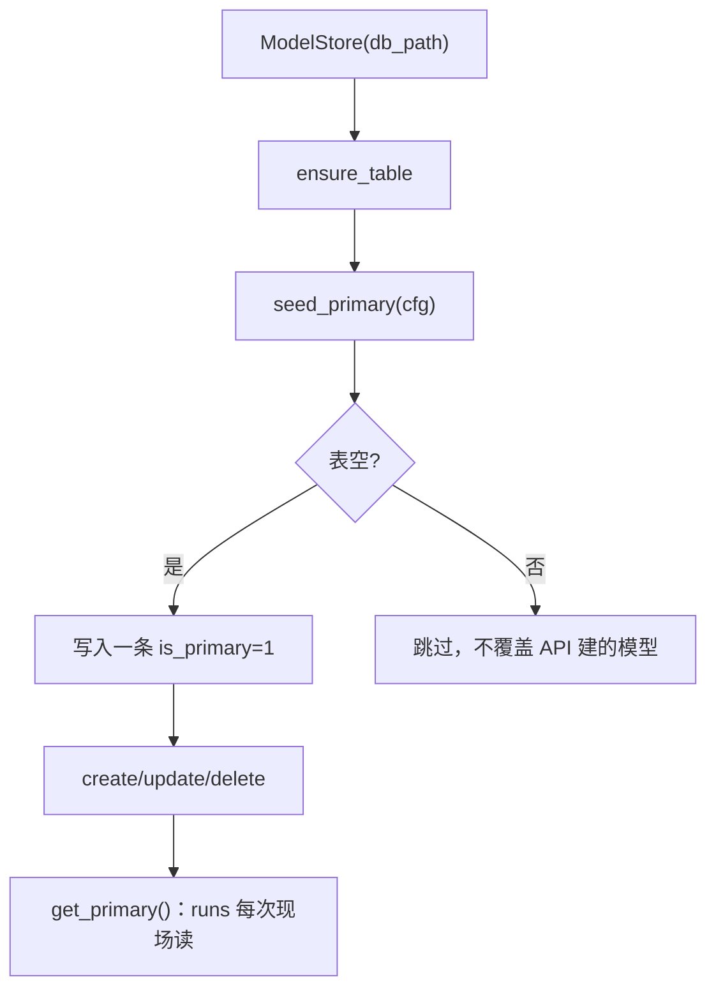

# gateway/model_store.py — model_store.py

> **文件路径**: `backend/app/gateway/model_store.py`
> **目录位置**: gateway → model_store.py
> **职责**: 模型配置 SQLite 存储（增删改查 + 主模型标记 + yaml 迁移）

## 📑 目录

- [📋 结构图 / 思维图](#📋-结构图--思维图)
- [📤 关键导出](#📤-关键导出)
- [💡 设计思想](#💡-设计思想)
- [🎯 实用场景](#🎯-实用场景)
- [🧩 顺序执行链](#🧩-顺序执行链)
- [❓ Q&A](#❓-qa)
- [⚠️ 风险点](#⚠️-风险点)

## 📋 结构图 / 思维图

**ASCII 版**：

```text
gateway_models 表（自包含建表，幂等）
  name(PK)/provider/base_url/model/api_key/temperature
  /is_primary/created_at/updated_at

ModelStore(db_path)
  ensure_table()                 ← lifespan 建表（幂等）
  seed_primary(cfg)              ← yaml chat 配置 → SQLite（表空才写）
  create/get/list_all/update/delete
  set_primary(name)/get_primary() ← 主模型唯一标记
  to_chat_config(row)            → ChatModelConfig（喂模型工厂）
  to_dict(row, mask_key=True)    → JSON dict（api_key 打码）
```

**Mermaid 版**：



## 📤 关键导出

**类**

- `ModelStore` — 模型配置 SQLite 数据访问

**常量**

- `GATEWAY_MODELS_SQL` — 建表 SQL（幂等）

## 💡 设计思想

1. **不裸连**：一律走 `persistence/db.py` 的 `connect()`（统一 WAL/Row/外键），沿用 `db_path + 线程本地连接` 模式（FastAPI 多请求线程安全）。
2. **runs 现场读主模型**：每次执行 `get_primary()`，改 SQLite 即生效，无需重启进程（验收点 4）。
3. **表自建在 gateway 包内**（CREATE IF NOT EXISTS），不改 `persistence/schema.py`——域边界自包含。

## 🎯 实用场景

1. 模型面板：POST /api/models 增模型 → 写 gateway_models
2. 切换主模型：PATCH /api/models/{name} `{is_primary:true}` → set_primary 翻转，下一次 run 生效
3. 启动迁移：config.yaml 的 chat 配置种子成主模型（首次启动）

## 🧩 顺序执行链

**验收点 4「不重启切换」的存储链**：

```text
request: PATCH /api/models/glm {is_primary:true}
   ▼  models.update(name=glm, fields)         ← 先改温度/base_url 等字段
   ▼  store.set_primary("glm")                 ← 事务：全部 is_primary=0 → glm=1
   ▼  return {is_primary:true}
—— 此时不重启进程 ——
request: POST /api/runs {message}  → stream
   ▼  runner 内 model_store.get_primary()      ← 现场读：已是 glm
   ▼  to_chat_config(row) → create_chat_model ← 用新模型跑
```

## 🧩 代码解析（成块对照 model_store.py）

### 块 1：线程本地连接——FastAPI 多请求下的 SQLite 安全

```python
class ModelStore:
    def __init__(self, db_path: str) -> None:
        self._db_path = db_path
        self._local = threading.local()

    @property
    def _conn(self) -> sqlite3.Connection:
        """当前线程的连接（每个线程各建一个，SQLite 线程安全标准做法）。"""
        c = getattr(self._local, "conn", None)
        if c is None:
            c = connect(self._db_path)  # 复用 persistence.db 统一配置
            self._local.conn = c
        return c
```

**关键点**：

- **`threading.local()` 每线程一条连接**：FastAPI 的 async 路由在**线程池**里执行（`anyio.to_thread` / Starlette 默认），不同请求落在不同线程。SQLite 连接默认不能跨线程使用（`check_same_thread=True` 会抛 `ProgrammingError`）——每线程一个连接是标准解法。
- **复用 `persistence/db.py` 的 `connect()`**：WAL 模式、Row 工厂、外键开启等统一配置在核心层，gateway 不自己裸连（避免两套 SQLite 配置打架）。
- **连接惰性创建、进程结束不主动 close**：WAL 模式下最后一个连接关闭时自动 checkpoint，不显式 close 是安全的（对齐核心层 `BaseRepository` 模式）。

### 块 2：`seed_primary` —— yaml→SQLite 迁移（幂等种子）

```python
def seed_primary(self, cfg: ChatModelConfig) -> bool:
    existing = self._conn.execute("SELECT COUNT(*) FROM gateway_models").fetchone()[0]
    if existing:
        return False
    now = _now()
    self._conn.execute(
        "INSERT INTO gateway_models (...) VALUES (?, ?, ?, ?, ?, ?, 1, ?, ?)",
        (cfg.model or "default", cfg.provider, cfg.base_url,
         cfg.model, cfg.api_key, cfg.temperature, now, now),
    )
    self._conn.commit()
    return True
```

**关键点**：

- **`if existing: return False` 是"不覆盖"护栏**：表里已有任何模型（哪怕是用户经 API 建的），yaml 种子就跳过——**配置文件的优先级低于运行时 API 创建**。防止重启后 yaml 旧配置覆盖用户在面板上的新选择。
- **硬编码 `is_primary = 1`**：首个种子模型直接当主模型，保证 runs 开箱可用（不用先 POST 一次）。
- 返回 `bool`：调用方（lifespan）可据此知道本次是否写入（调试/日志用）。

### 块 3：`create` + `set_primary` + `get_primary` —— 主模型唯一性

```python
def create(self, name, provider="openai-compatible", ..., make_primary=False):
    if self.get(name) is not None:
        raise ValueError(f"模型已存在: {name}")
    count = self._conn.execute("SELECT COUNT(*) FROM gateway_models").fetchone()[0]
    primary = 1 if (make_primary or count == 0) else 0
    if primary:
        self._conn.execute("UPDATE gateway_models SET is_primary = 0")
    self._conn.execute("INSERT INTO gateway_models (...) VALUES (?, ?, ?, ?, ?, ?, ?, ?, ?)", ...)
    self._conn.commit()
    return self.get(name)

def set_primary(self, name: str) -> None:
    if self.get(name) is None:
        raise ValueError(f"模型不存在: {name}")
    self._conn.execute("UPDATE gateway_models SET is_primary = 0")
    self._conn.execute("UPDATE gateway_models SET is_primary = 1 WHERE name = ?", (name,))
    self._conn.commit()

def get_primary(self) -> sqlite3.Row | None:
    row = self._conn.execute("SELECT * FROM gateway_models WHERE is_primary = 1 LIMIT 1").fetchone()
    if row is not None:
        return row
    return self._conn.execute("SELECT * FROM gateway_models ORDER BY created_at ASC LIMIT 1").fetchone()
```

**关键点**：

- **`is_primary` 唯一性靠"先清零再置位"两步**（`set_primary`）：不是 `UPDATE ... SET is_primary=1 WHERE is_primary=0` 的条件更新，而是**无条件的全表清零 + 目标置位**——保证任何时刻最多一行=1（也兼容"把已是主模型的再设一次"）。
- **`create` 首个模型自动主**：`count == 0` 时无视 `make_primary` 直接主——开箱即用，避免"建了模型但 runs 报未配置主模型"。
- **`get_primary` 的兜底回退**：理论上 `is_primary=1` 最多一行，但数据异常（如手工改库）导致无主模型时，回退取**最早创建的一行**——尽力服务，不抛异常。`delete` 主模型时也靠这个回退逻辑（`delete` 后无主模型 → `get_primary` 取剩余第一行）。

### 块 4：`update`（PATCH 局部更新）+ `to_dict`（打码）

```python
def update(self, name: str, **fields: object) -> sqlite3.Row:
    allowed = {"provider", "base_url", "model", "api_key", "temperature"}
    sets = [f"{k} = ?" for k in fields if k in allowed]
    if not sets:
        return self.get(name)
    params = [fields[k] for k in fields if k in allowed]
    params.append(_now()); params.append(name)
    self._conn.execute(f"UPDATE gateway_models SET {', '.join(sets)}, updated_at = ? WHERE name = ?", tuple(params))
    self._conn.commit()
    return self.get(name)

@staticmethod
def to_dict(row, *, mask_key=True):
    api_key = row["api_key"] or ""
    if mask_key and api_key:
        api_key = f"****{api_key[-4:]}" if len(api_key) > 4 else "****"
    return {..., "api_key": api_key, "is_primary": bool(row["is_primary"]), ...}
```

**关键点**：

- **白名单字段 + 动态拼 SET**：`allowed` 集合过滤传入字段（防止 SQL 注入——字段名不是参数化能保护的，白名单是必须的），再 `', '.join(sets)` 拼 SET 子句。**`is_primary` 不在白名单**——切换主模型走 `set_primary` 独立方法（见路由层 models.py 的 PATCH 两步：先字段更新、再处理 is_primary）。
- **`to_dict` 的 `bool(row["is_primary"])`**：SQLite 存 0/1 整数，转 JSON 时变 bool（前端友好）。
- **`mask_key` 默认打码**：对外 `GET /api/models` 返回 `****末4位`；只有内部 `to_chat_config`（转给模型工厂）用明文行。

## ❓ Q&A / 知识点

**Q: api_key 明文存库安全吗？**
A: 本地单机调试可接受；对外 GET 默认 `mask_key=True`（`****末4位`），日志也不打印明文。生产应考虑加密或环境变量注入（原版用 credential_loader/环境变量体系，M7 裁剪成本地明文 + 打码）。

**Q: 删了主模型会怎样？**
A: `delete` 把该行删掉后，库里可能没有 `is_primary=1` 的行——但 `get_primary()` 有兜底回退（取最早创建的一行），runs 下一次执行时自然拿到替补，不会报"未配置主模型"。这是"尽力服务"设计：面板删主模型不崩对话链路。

**Q: 为什么 `update` 的字段白名单里没有 `is_primary`？**
A: `is_primary` 不是"字段更新"而是"状态翻转"（语义：设置主模型 = 其他全部降级）。混进 PATCH 字段会导致"只更新 is_primary 时忘了清其他行"的 bug。所以路由层 models.py 的 PATCH 分两步：`store.update(name, **fields)`（白名单字段）→ `store.set_primary(name)`（翻转）。职责单一。

**Q: 为什么 `seed_primary` 要"表空才写"，而不是"yaml 优先"？**
A: 两条原则：① 运行时 API 创建的模型优先级高于配置文件（用户主动配置 > 默认配置）；② 幂等——重启不重复插入（PRIMARY KEY 冲突会炸）。`if existing: return False` 同时满足两者。代价：改 config.yaml 后不会自动同步到 SQLite，需在面板上改（M7 明确取舍）。

## ⚠️ 风险点

1. api_key 入库为明文；对外打码但库内仍是明文（生产需加固）
2. `is_primary` 同一时刻只允许一行=1；`set_primary` 用两步事务翻转
3. db_path 模式每线程一连接，进程结束不主动 close（WAL 安全）
4. `get_primary` 兜底回退依赖"created_at 最早"——若手工改库把 created_at 改乱，替补选择可能不符合预期
5. `update` 动态拼 SET 依赖白名单过滤，新增可更新字段必须同步加进 `allowed`

> 页脚：2026-10-13 · M7 Gateway 核心 · 对齐 `evoflow/persistence/model_connections.py`（裁剪）
