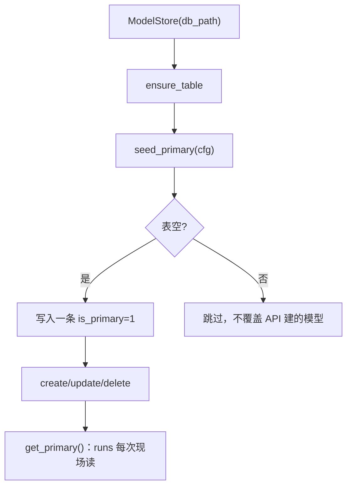

# gateway/model_store.py — model_store.py

> **文件路径**: `backend/app/gateway/model_store.py`
> **目录位置**: gateway → model_store.py
> **职责**: 模型配置 SQLite 存储（增删改查 + 主模型标记 + yaml 迁移）

## 📑 目录

- [📋 结构图 / 思维图](#📋-结构图--思维图)
- [📤 关键导出](#📤-关键导出)
- [💡 设计思想](#💡-设计思想)
- [🎯 实用场景](#🎯-实用场景)
- [🧩 顺序执行链](#🧩-顺序执行链)
- [❓ Q&A](#❓-qa)
- [⚠️ 风险点](#⚠️-风险点)

## 📋 结构图 / 思维图

**ASCII 版**：

```text
gateway_models 表（自包含建表，幂等）
  name(PK)/provider/base_url/model/api_key/temperature
  /is_primary/created_at/updated_at

ModelStore(db_path)
  ensure_table()                 ← lifespan 建表（幂等）
  seed_primary(cfg)              ← yaml chat 配置 → SQLite（表空才写）
  create/get/list_all/update/delete
  set_primary(name)/get_primary() ← 主模型唯一标记
  to_chat_config(row)            → ChatModelConfig（喂模型工厂）
  to_dict(row, mask_key=True)    → JSON dict（api_key 打码）
```

**Mermaid 版**：



## 📤 关键导出

**类**

- `ModelStore` — 模型配置 SQLite 数据访问

**常量**

- `GATEWAY_MODELS_SQL` — 建表 SQL（幂等）

## 💡 设计思想

1. **不裸连**：一律走 `persistence/db.py` 的 `connect()`（统一 WAL/Row/外键），沿用 `db_path + 线程本地连接` 模式（FastAPI 多请求线程安全）。
2. **runs 现场读主模型**：每次执行 `get_primary()`，改 SQLite 即生效，无需重启进程（验收点 4）。
3. **表自建在 gateway 包内**（CREATE IF NOT EXISTS），不改 `persistence/schema.py`——域边界自包含。

## 🎯 实用场景

1. 模型面板：POST /api/models 增模型 → 写 gateway_models
2. 切换主模型：PATCH /api/models/{name} `{is_primary:true}` → set_primary 翻转，下一次 run 生效
3. 启动迁移：config.yaml 的 chat 配置种子成主模型（首次启动）

## 🧩 顺序执行链

**验收点 4「不重启切换」的存储链**：

```text
request: PATCH /api/models/glm {is_primary:true}
   ▼  models.update(name=glm, fields)         ← 先改温度/base_url 等字段
   ▼  store.set_primary("glm")                 ← 事务：全部 is_primary=0 → glm=1
   ▼  return {is_primary:true}
—— 此时不重启进程 ——
request: POST /api/runs {message}  → stream
   ▼  runner 内 model_store.get_primary()      ← 现场读：已是 glm
   ▼  to_chat_config(row) → create_chat_model ← 用新模型跑
```

## ❓ Q&A

**Q: api_key 明文存库安全吗？**
A: 本地单机调试可接受；对外 GET 默认 `mask_key=True`（`****末4位`），日志也不打印明文。生产应考虑加密或环境变量注入。

**Q: 删了主模型会怎样？**
A: `delete` 自动把剩余第一行提为主模型，避免 runs 找不到主模型而报错。

## ⚠️ 风险点

1. api_key 入库为明文；对外打码但库内仍是明文（生产需加固）
2. `is_primary` 同一时刻只允许一行=1；`set_primary` 用两步事务翻转
3. db_path 模式每线程一连接，进程结束不主动 close（WAL 安全）
