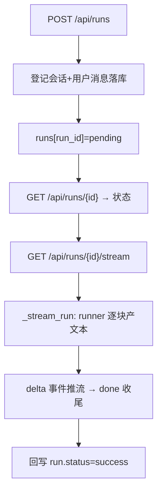

# gateway/routers/runs.py — runs.py

> **文件路径**: `backend/app/gateway/routers/runs.py`
> **目录位置**: gateway/routers → runs.py
> **职责**: 对话运行 API + SSE 流式（发起 run / 查状态 / 流式取回复）

## 📑 目录

- [📋 结构图 / 思维图](#📋-结构图--思维图)
- [📤 关键导出](#📤-关键导出)
- [💡 设计思想](#💡-设计思想)
- [🎯 实用场景](#🎯-实用场景)
- [🧩 顺序执行链](#🧩-顺序执行链)
- [❓ Q&A](#❓-qa)
- [⚠️ 风险点](#⚠️-风险点)

## 📋 结构图 / 思维图

```text
router(prefix="/api", tags=["runs"])
  POST /api/runs               → 建 run（登记会话/消息，返回 run_id）
  GET  /api/runs/{run_id}     → 查 run 状态/回复
  GET  /api/runs/{run_id}/stream → SSE 逐块推回复

执行体: app.state.runner(thread_id, message) → 异步生成器产文本
  （默认=真 agent；测试注入 fake，不联网）
run 注册表: app.state.runs[run_id] = {status, response, ...}
```

**Mermaid 版**：



## 📤 关键导出

**router** — `runs.router`

## 💡 设计思想

1. **三段式对齐验收**：POST 只登记 run（返回 run_id）；GET 查状态；stream 才真正跑 agent 并逐块推送——分离"发起"与"执行"。
2. **runner 注入点**：`app.state.runner` 是 `async(thread_id, message)->AsyncIterator[str]`。默认装真 agent；测试传 fake → 全程离线。
3. **run 注册表内存化**：run 是临时执行句柄；业务记录落 sessions SQLite，图状态落 checkpointer——重启后 run_id 无需恢复。

## 🎯 实用场景

1. 发起对话：POST /api/runs 带消息 → 拿 run_id
2. 轮询状态：GET /api/runs/{id} 看 pending/running/success/failed
3. 流式接收：GET /api/runs/{id}/stream 订阅 SSE 逐块渲染

## 🧩 顺序执行链

**POST /api/runs 发起链**：

```text
request: POST /api/runs {message, thread_id?}
   ▼  create_run(request, body)
   ▼  thread_id = body.thread_id or 自动生成
   ▼  sessions.create(thread_id) + add_message(user, message)  ← 落 SQLite
   ▼  app.state.runs[run_id] = {status:"pending", ...}        ← 内存执行态
   ▼  return 201 {run_id, thread_id, status:"pending"}
```

**SSE 流式链**（`GET /api/runs/{id}/stream`）：

```text
request: GET /api/runs/{run_id}/stream
   ▼  取 run；不存在 → 404
   ▼  EventSourceResponse(_stream_run(request, run))
   ▼  run.status = "running"
   ▼  async for chunk in app.state.runner(thread_id, message):
   ▼     yield delta_event(chunk)        ← event: delta\ndata:{delta}
   ▼  run.status="success"; run.response=full
   ▼  yield done_event(full)             ← event: done\ndata:{status,response}
```

## ❓ Q&A

**Q: run 注册表为什么放内存？**
A: run 是执行态；其持久记录是 session_messages + checkpoint。M7 单进程够用，重启后 run_id 失效可接受。

**Q: 重复订阅 stream 会怎样？**
A: 每次 GET stream 都重新执行一次 runner（独立执行）。

## ⚠️ 风险点

1. run 注册表是进程内 dict：多副本/重启后 run_id 失效（M7 单进程）
2. SSE 客户端断开会中断生成器；`_stream_run` 已 try/except 兜异常并回写状态
