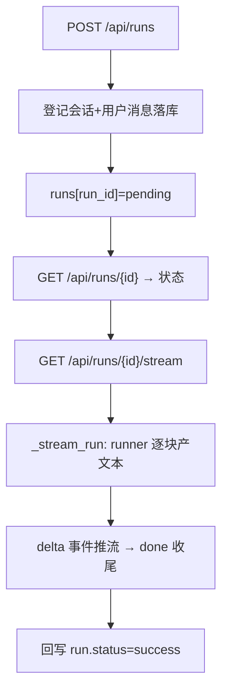

# gateway/routers/runs.py — runs.py

> **文件路径**: `backend/app/gateway/routers/runs.py`
> **目录位置**: gateway/routers → runs.py
> **职责**: 对话运行 API + SSE 流式（发起 run / 查状态 / 流式取回复）

## 📑 目录

- [📋 结构图 / 思维图](#📋-结构图--思维图)
- [📤 关键导出](#📤-关键导出)
- [💡 设计思想](#💡-设计思想)
- [🎯 实用场景](#🎯-实用场景)
- [🧩 顺序执行链](#🧩-顺序执行链)
- [❓ Q&A](#❓-qa)
- [⚠️ 风险点](#⚠️-风险点)

## 📋 结构图 / 思维图

```text
router(prefix="/api", tags=["runs"])
  POST /api/runs               → 建 run（登记会话/消息，返回 run_id）
  GET  /api/runs/{run_id}     → 查 run 状态/回复
  GET  /api/runs/{run_id}/stream → SSE 逐块推回复

执行体: app.state.runner(thread_id, message) → 异步生成器产文本
  （默认=真 agent；测试注入 fake，不联网）
run 注册表: app.state.runs[run_id] = {status, response, ...}
```

**Mermaid 版**：



## 📤 关键导出

**router** — `runs.router`

## 💡 设计思想

1. **三段式对齐验收**：POST 只登记 run（返回 run_id）；GET 查状态；stream 才真正跑 agent 并逐块推送——分离"发起"与"执行"。
2. **runner 注入点**：`app.state.runner` 是 `async(thread_id, message)->AsyncIterator[str]`。默认装真 agent；测试传 fake → 全程离线。
3. **run 注册表内存化**：run 是临时执行句柄；业务记录落 sessions SQLite，图状态落 checkpointer——重启后 run_id 无需恢复。

## 🎯 实用场景

1. 发起对话：POST /api/runs 带消息 → 拿 run_id
2. 轮询状态：GET /api/runs/{id} 看 pending/running/success/failed
3. 流式接收：GET /api/runs/{id}/stream 订阅 SSE 逐块渲染

## 🧩 顺序执行链

**POST /api/runs 发起链**：

```text
request: POST /api/runs {message, thread_id?}
   ▼  create_run(request, body)
   ▼  thread_id = body.thread_id or 自动生成
   ▼  sessions.create(thread_id) + add_message(user, message)  ← 落 SQLite
   ▼  app.state.runs[run_id] = {status:"pending", ...}        ← 内存执行态
   ▼  return 201 {run_id, thread_id, status:"pending"}
```

**SSE 流式链**（`GET /api/runs/{id}/stream`）：

```text
request: GET /api/runs/{run_id}/stream
   ▼  取 run；不存在 → 404
   ▼  EventSourceResponse(_stream_run(request, run))
   ▼  run.status = "running"
   ▼  async for chunk in app.state.runner(thread_id, message):
   ▼     yield delta_event(chunk)        ← event: delta\ndata:{delta}
   ▼  run.status="success"; run.response=full
   ▼  yield done_event(full)             ← event: done\ndata:{status,response}
```

## 🧩 代码解析（成块对照 runs.py）

### 块 1：`create_run` —— 发起即登记，不执行

```python
@router.post("/runs", status_code=201)
async def create_run(request: Request, body: RunCreate) -> dict:
    state = request.app.state
    thread_id = body.thread_id or os.urandom(8).hex()
    run_id = _new_run_id()   # "r_" + os.urandom(6).hex()

    state.sessions.create(thread_id)                 # 幂等建会话
    state.sessions.add_message(thread_id, "user", body.message)  # 用户消息落库

    state.runs[run_id] = {
        "run_id": run_id, "thread_id": thread_id, "message": body.message,
        "status": "pending", "response": "", "error": "",
        "created_at": now, "updated_at": now,
    }
    return {"run_id": run_id, "thread_id": thread_id, "status": "pending"}
```

**关键点**：

- **POST 不执行 agent**：只"登记意图"（写会话 + 用户消息 + 建 run 记录）。执行放在 stream——**发起与执行分离**，前端可以先拿到 run_id 再决定是否订阅流。
- **thread_id 两种来源**：body 显式传（复用旧会话/多轮）或自动生成（`os.urandom(8).hex()` = 16 位 hex）。`sessions.create` 幂等（INSERT OR IGNORE），同一 thread 多次 POST 不炸。
- **run_id 与 thread_id 是两回事**：run_id（`r_` 前缀）是一次执行的临时句柄；thread_id 是会话语义（LangGraph checkpoint 的钥匙）。前端用 run_id 订阅流，用 thread_id 组织会话列表。
- 业务记录（会话+明文消息）落 SQLite，run 执行态落内存——**审计与执行分离**。

### 块 2：`_stream_run` —— SSE 执行体（核心）

```python
async def _stream_run(request: Request, run: dict) -> AsyncIterator[dict]:
    state = request.app.state
    run["status"] = "running"
    run["updated_at"] = datetime.now(UTC).isoformat()
    full = ""
    try:
        async for chunk in state.runner(run["thread_id"], run["message"]):
            if chunk:
                full += chunk
                yield delta_event(chunk)
        run["status"] = "success"
        run["response"] = full
        yield done_event(full)
    except Exception as exc:  # noqa: BLE001 —— run 失败回写状态并推 error 事件，不崩服务
        run["status"] = "failed"
        run["error"] = str(exc)[:300]
        yield error_event(str(exc)[:300])
```

**关键点**：

- **`state.runner` 是唯一执行入口**：`async(thread_id, message) -> AsyncIterator[str]`。生产 = `_build_default_runner`（真 agent），测试 = fake。**路由层对"谁在跑"零感知**——这是可测性的核心。
- **状态回写贯穿执行**：`pending → running → success/failed`，SSE 推流的同时 GET /runs/{id} 可随时查到最新状态（轮询与流式共用一份 run 记录）。
- **`full` 累积 + done 携带完整回复**：与 sse.py 的 `sse_text_stream` 同理——前端复制/持久化用完整文本，且保证 SSE 推送与 GET 查询结果一致（同一份 `run["response"]`）。
- **`str(exc)[:300]` 截断**：错误信息写回 run 记录和 error 事件都截断到 300 字符——避免把敏感堆栈/超长异常文本推给前端。
- **`except Exception`（BLE001）**：SSE 生成器里的异常不能让服务崩（客户端正挂着连接）；转成 error 事件 + 状态 failed，进程继续服务。

### 块 3：`stream_run` —— SSE 端点接线

```python
@router.get("/runs/{run_id}/stream")
async def stream_run(request: Request, run_id: str):
    run = request.app.state.runs.get(run_id)
    if run is None:
        raise HTTPException(status_code=404, detail=f"run 不存在: {run_id}")
    return EventSourceResponse(_stream_run(request, run))
```

**关键点**：

- **`EventSourceResponse` 直接接收异步生成器**：sse-starlette 自动按 SSE 帧编码 + 处理客户端断连（取消生成器）。
- **404 检查在订阅前**：run_id 不存在直接 HTTP 404（而非"订阅一个空流"）——失败要快速失败。
- 注意 `_stream_run(request, run)` 传的是**同一个 run dict 引用**——状态回写就是改这个 dict，GET 端点读的也是它。

## ❓ Q&A / 知识点

**Q: run 注册表为什么放内存？**
A: run 是执行态；其持久记录是 session_messages + checkpoint。M7 单进程够用，重启后 run_id 失效可接受。多副本/多进程场景需要换 Redis/DB（学习路线 M8+ 已标注）。

**Q: 重复订阅 stream 会怎样？**
A: 每次 GET stream 都重新执行一次 runner（独立执行）——`_stream_run` 每次从 `run["message"]` 重新跑。这是"拉式流"语义：订阅一次 = 执行一次。若要做"一次执行多端订阅"（SSE 扇出），需要把 runner 执行与连接解耦（队列广播），M7 不做。

**Q: 为什么"发起 run"和"执行 run"要分离成 POST 和 stream 两个端点？**
A: 三个原因：① 前端可以先创建 run 拿到 run_id，再按需订阅流（用户可能关掉流式只轮询）；② SSE 连接失败时可重新 GET stream 重跑，run 记录已存在；③ 对齐验收的三段式（发起/状态/流式）。合并成一个 POST 返回流会让"状态查询"无从谈起。

**Q: `run["error"]` 为什么要截断 300 字符？**
A: 异常文本可能含完整堆栈（含路径、密钥片段、模型原始报错），直接推给前端是信息泄露面 + 超长 payload。截断保留"可诊断的核心信息"，同时 GET 返回体保持轻量。

## ⚠️ 风险点

1. run 注册表是进程内 dict：多副本/重启后 run_id 失效（M7 单进程）
2. SSE 客户端断开会中断生成器；`_stream_run` 已 try/except 兜异常并回写状态
3. GET stream 重复订阅会重跑一次 runner（"订阅一次=执行一次"语义）
4. 同步 agent.invoke 的阻塞由 `_build_default_runner` 里的 `anyio.to_thread` 隔离；若 runner 换成真流式（astream），`_stream_run` 接口无需变

> 页脚：2026-10-13 · M7 Gateway 核心 · 对齐 `evoflow/gateway/routers/runs.py`（裁剪）
