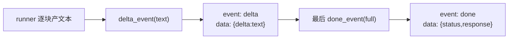

# gateway/sse.py — sse.py

> **文件路径**: `backend/app/gateway/sse.py`
> **目录位置**: gateway → sse.py
> **职责**: SSE 流式输出（裁剪版：delta / done / error 三类事件）

## 📑 目录

- [📋 结构图 / 思维图](#📋-结构图--思维图)
- [📤 关键导出](#📤-关键导出)
- [💡 设计思想](#💡-设计思想)
- [🎯 实用场景](#🎯-实用场景)
- [🧩 顺序执行链](#🧩-顺序执行链)
- [❓ Q&A](#❓-qa)
- [⚠️ 风险点](#⚠️-风险点)

## 📋 结构图 / 思维图

**ASCII 版**：

```text
delta_event(text) → {"event":"delta","data":{json}}   ← 一块回复文本
done_event(full)  → {"event":"done","data":{...}}     ← 流结束（带完整回复）
error_event(msg)  → {"event":"error","data":{...}}    ← 流失败

sse_text_stream(chunks) → 把"逐块产文本"异步生成器包成事件流
EventSourceResponse(content)   ← sse-starlette re-export
```

**Mermaid 版**：



## 📤 关键导出

**函数**

- `delta_event` / `done_event` / `error_event` — 构造标准 SSE 事件 dict
- `sse_text_stream` — 把文本块异步生成器包成 SSE 事件流

**re-export**

- `EventSourceResponse`（sse-starlette）

## 💡 设计思想

1. **裁剪对齐**：原版 SSE 归一化复杂（messages/values/end 多事件 + 裁剪去重），M7 只暴露三种语义：delta / done / error，前端按 event 分支即可。
2. **帧编码交给 sse-starlette**：本模块只产事件 dict，心跳/编码由 `EventSourceResponse` 处理。
3. **统一手动 `json.dumps`**：`data` 一律序列化成字符串，避免版本差异导致双重编码。

## 🎯 实用场景

1. 路由层 `GET /api/runs/{id}/stream` → `EventSourceResponse(_stream_run(...))`
2. 前端按 `event: delta` 逐块渲染打字机效果，`done` 收尾，`error` 提示失败

## 🧩 顺序执行链

**SSE 事件帧产出链**：

```text
runner.async for chunk in text:
   ▼  if chunk: yield delta_event(chunk)        ← event: delta\ndata: {"delta":"..."}
   ▼  full += chunk
流结束
   ▼  yield done_event(full)                     ← event: done\ndata: {"status":"success","response":full}
异常
   ▼  yield error_event(msg)                     ← event: error\ndata: {"error":"..."}
```

## 🧩 代码解析（成块对照 sse.py）

### 块 1：事件构造函数——SSE 的"载荷字典"约定

```python
def delta_event(text: str) -> dict:
    """一块回复文本：event=delta, data={"delta": text}。"""
    return {"event": "delta", "data": json.dumps({"delta": text}, ensure_ascii=False)}

def done_event(full_text: str) -> dict:
    """流结束：event=done, data={"status":"success","response": full_text}。"""
    return {"event": "done", "data": json.dumps(
        {"status": "success", "response": full_text}, ensure_ascii=False)}

def error_event(message: str) -> dict:
    """流失败：event=error, data={"error": message}。"""
    return {"event": "error", "data": json.dumps({"error": message}, ensure_ascii=False)}
```

**关键点**：

- **返回的不是 SSE 帧字符串，而是事件 dict**：`sse-starlette` 的 `EventSourceResponse` 会遍历这个 dict 生成器，自动按 `event: X\ndata: Y\n\n` 帧格式编码。本模块只负责"事件语义"，不碰帧协议。
- **`data` 手动 `json.dumps` 成字符串**：SSE 的 `data:` 字段按规范是字符串；若直接传 dict，不同版本 sse-starlette 的处理不一致（有的会再 dumps 一次造成双重编码，有的报错）。统一手动 dumps 最稳。
- **`ensure_ascii=False`**：中文回复不转义成 `\uXXXX`，前端拿到的 data 直接可读；同时 `data:` 行内不含换行（json.dumps 会转义），不会破坏 SSE 帧结构。
- **事件名固定三个**：`delta`（文本块）/ `done`（流结束，附完整回复）/ `error`（失败）——前端 `addEventListener` 按名分支，不用解析 OpenAI chunk 结构。

### 块 2：`sse_text_stream` —— 文本块 → 事件流的桥

```python
async def sse_text_stream(chunks: AsyncIterator[str]) -> AsyncIterator[dict]:
    full = ""
    async for text in chunks:
        if text:
            full += text
            yield delta_event(text)
    yield done_event(full)
```

**关键点**：

- **`full` 累积**：SSE 前端即使逐块渲染，也要在 `done` 拿到完整回复（用于复制/持久化）；所以这里同时攒 `full`。
- **`if text:` 过滤空块**：runner 可能 yield 空字符串（模型输出空白段），跳过避免发"空 delta"。
- **消费端契约**：`chunks` 是 `AsyncIterator[str]`——任何"异步逐块产文本"的东西都能塞进来（真 agent 的流、fake runner、测试生成器）。路由层 `EventSourceResponse(sse_text_stream(my_gen))` 一行接上。

## ❓ Q&A / 知识点

**Q: 为什么不用原版的 openai_stream_normalize？**
A: 原版是把 OpenAI chunk（`choices[0].delta.content` 结构）归一化成前端 UI 事件（messages/values/end 多事件 + 裁剪去重）。M7 的 runner 已经是"文本块"语义——底层差异被 `_build_default_runner`/fake runner 屏蔽了，路由层不需要再解析 OpenAI chunk。裁剪成三种事件更简单，前端心智负担最小。

**Q: `done_event` 为什么把完整回复也带上？前端不是已经逐块收到了吗？**
A: 三个原因：① 前端逐块渲染后，最终要展示/复制完整回复，与其让前端自己拼接，不如服务端直接给；② `full` 在服务端是权威版本（过滤了空块后的精确拼接）；③ run 状态回写（`run["response"] = full`）也复用同一份，保证 SSE 推的和 GET /runs/{id} 查到的完全一致。

**Q: 客户端中途断开（刷新页面/断网）会发生什么？**
A: `EventSourceResponse` 检测到连接关闭后，会向生成器抛 `anyio` 取消（`CancelledError`/`GeneratorExit`）——`async for chunk in state.runner(...)` 被打断。路由层 `_stream_run` 的 `try/except Exception` 会捕获并回写 `run["status"]="failed"`、`error="...cancel..."`，然后进程继续服务其他请求，不崩。前端重连后 GET 查到的状态是 failed，不是挂起。

**Q: 为什么事件名固定为 delta/done/error，而不是原版的 messages/values/end？**
A: 原版事件名对应"OpenAI 协议结构"（消息、值、结束），M7 对应"文本流语义"（一块文本、结束、失败）。前端对接成本：三个事件名 + 一个 data 结构，比解析 OpenAI chunk 低一个量级。若后续要做"工具调用事件/状态事件"，在 `sse_text_stream` 里加新事件类型即可，契约向后兼容。

## ⚠️ 风险点

1. `data` 必须是 JSON 字符串（手动 dumps 最稳）
2. 客户端断开会在生成器抛异常；路由层 `_stream_run` 已 try/except 回写 run 状态
3. `done` 事件只在流正常结束才发；异常走 `error`，前端两者必须都处理
4. 空块被过滤——若 runner 语义上"空白也有意义"（如渲染空行），过滤会丢；M7 文本回复场景无此问题

> 页脚：2026-10-13 · M7 Gateway 核心 · 对齐 `evoflow/gateway/openai_stream_normalize.py`（裁剪）
