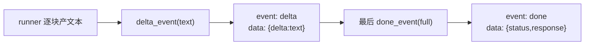

# gateway/sse.py — sse.py

> **文件路径**: `backend/packages/harness/agentflow/gateway/sse.py`
> **目录位置**: gateway → sse.py
> **职责**: SSE 流式输出（裁剪版：delta / done / error 三类事件）

## 📑 目录

- [📋 结构图 / 思维图](#📋-结构图--思维图)
- [📤 关键导出](#📤-关键导出)
- [💡 设计思想](#💡-设计思想)
- [🎯 实用场景](#🎯-实用场景)
- [🧩 顺序执行链](#🧩-顺序执行链)
- [❓ Q&A](#❓-qa)
- [⚠️ 风险点](#⚠️-风险点)

## 📋 结构图 / 思维图

**ASCII 版**：

```text
delta_event(text) → {"event":"delta","data":{json}}   ← 一块回复文本
done_event(full)  → {"event":"done","data":{...}}     ← 流结束（带完整回复）
error_event(msg)  → {"event":"error","data":{...}}    ← 流失败

sse_text_stream(chunks) → 把"逐块产文本"异步生成器包成事件流
EventSourceResponse(content)   ← sse-starlette re-export
```

**Mermaid 版**：



## 📤 关键导出

**函数**

- `delta_event` / `done_event` / `error_event` — 构造标准 SSE 事件 dict
- `sse_text_stream` — 把文本块异步生成器包成 SSE 事件流

**re-export**

- `EventSourceResponse`（sse-starlette）

## 💡 设计思想

1. **裁剪对齐**：原版 SSE 归一化复杂（messages/values/end 多事件 + 裁剪去重），M7 只暴露三种语义：delta / done / error，前端按 event 分支即可。
2. **帧编码交给 sse-starlette**：本模块只产事件 dict，心跳/编码由 `EventSourceResponse` 处理。
3. **统一手动 `json.dumps`**：`data` 一律序列化成字符串，避免版本差异导致双重编码。

## 🎯 实用场景

1. 路由层 `GET /api/runs/{id}/stream` → `EventSourceResponse(_stream_run(...))`
2. 前端按 `event: delta` 逐块渲染打字机效果，`done` 收尾，`error` 提示失败

## 🧩 顺序执行链

**SSE 事件帧产出链**：

```text
runner.async for chunk in text:
   ▼  if chunk: yield delta_event(chunk)        ← event: delta\ndata: {"delta":"..."}
   ▼  full += chunk
流结束
   ▼  yield done_event(full)                     ← event: done\ndata: {"status":"success","response":full}
异常
   ▼  yield error_event(msg)                     ← event: error\ndata: {"error":"..."}
```

## ❓ Q&A

**Q: 为什么不用原版的 openai_stream_normalize？**
A: 原版是把 OpenAI chunk 归一化成前端 UI 事件；M7 的 runner 已经是"文本块"语义，不需要再解析 OpenAI chunk，裁剪成三种事件更简单。

## ⚠️ 风险点

1. `data` 必须是 JSON 字符串（手动 dumps 最稳）
2. 客户端断开会在生成器抛异常；路由层 `_stream_run` 已 try/except 回写 run 状态
