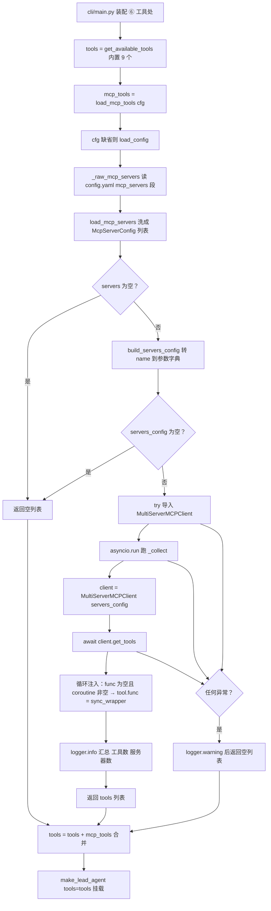

# mcp/tools.py — tools.py

> **文件路径**: `backend/packages/harness/agentflow/mcp/tools.py`
> **目录位置**: mcp → tools.py
> **职责**: 从 config.yaml 加载 MCP 外部服务器并返回 BaseTool 列表；给 async-only 的 MCP 工具注入同步调用入口（M6）

## 📑 目录

- [📋 结构图](#📋-结构图)
- [📤 关键导出](#📤-关键导出)
- [💡 设计思想](#💡-设计思想)
- [🎯 实用场景](#🎯-实用场景)
- [📊 顺序执行链流程图](#📊-顺序执行链流程图)
- [🧩 代码解析（成块对照 tools.py）](#🧩-代码解析成块对照-toolspy)
- [❓ Q&A / 知识点](#❓-qa--知识点)
- [⚠️ 风险点](#⚠️-风险点)

## 📋 结构图

```text
┌──────────────────────────────────────────────────────────────┐
│ _SYNC_TOOL_EXECUTOR（模块级线程池 max_workers=10）+ atexit   │
│ _make_sync_tool_wrapper(coro, name) → sync_wrapper           │
│   ├─ 每次调用开 fresh loop（隔离事件循环）                    │
│   ├─ 外层已有 running loop → 提交线程池跑 fresh loop          │
│   └─ 给 async-only 工具注入 .func（CLI 同步调用可用）         │
│                                                              │
│ load_mcp_tools(cfg)                                          │
│   ├─ cfg = cfg or load_config()                              │
│   ├─ load_mcp_servers({"mcp_servers": _raw_mcp_servers(cfg)})│
│   │     空列表 → return []（无 MCP 配置就不折腾）             │
│   ├─ build_servers_config → {name: params}                  │
│   │     空 → return []                                       │
│   ├─ MultiServerMCPClient(servers)  ← langchain-mcp-adapters │
│   ├─ async def _collect(): client.get_tools()                │
│   │     → 对 func is None 且 coroutine 非空的工具             │
│   │       tool.func = _make_sync_tool_wrapper(...)           │
│   └─ asyncio.run(_collect()) 同步桥接 → list[BaseTool]       │
│                                                              │
│   任何异常 → logger.warning + return []（可选项降级）         │
└──────────────────────────────────────────────────────────────┘
```

## 📤 关键导出

**函数**

- `load_mcp_tools(cfg=None)`：加载全部启用 MCP 服务器的工具，合并成 `list[BaseTool]`；
  配置为空 / 连接失败一律返回 `[]`（可选项语义，不抛错）
- `_make_sync_tool_wrapper(coro, tool_name)`：给 async-only 的 MCP 工具造同步调用入口
  （`func`），核心规则 = 绝不在已有 running loop 上跑 `asyncio.run`

**模块级常量**

- `_SYNC_TOOL_EXECUTOR`：`ThreadPoolExecutor(max_workers=10, thread_name_prefix="mcp-sync-tool")`
  全局线程池，`atexit` 注册关闭——async 环境里同步调用的兜底提交池

**内部私有**

- `_raw_mcp_servers(cfg)`：从 config.yaml 读 `mcp_servers` 原始 list

## 💡 设计思想

1. **MCP 工具是可选组件**：连接失败 / 配置为空返回 `[]`；已接入主装配
   （`cli/main.py` ⑥ 工具处 `tools = tools + mcp_tools`）。
2. **两层同步桥接**：① 拿工具时 `asyncio.run(_collect())`（装配链同步 → adapter async API）；
   ② 工具调用时 `_make_sync_tool_wrapper`——MCP 工具只带 coroutine、无 `func`，
   CLI 同步调用会报 `StructuredTool does not support sync invocation`，注入 sync_wrapper 解决。
3. **绝不在 running loop 上跑 asyncio.run**：每次调用用隔离 fresh loop；外层已有
   running loop（未来 gateway 异步环境）→ 提交线程池跑 fresh loop——这就是
   `_SYNC_TOOL_EXECUTOR` 存在的原因。
4. **懒加载**：只有调 `load_mcp_tools` 时才建客户端（不常驻连接）。

## 🎯 实用场景

1. **主装配接线（M6→M7 交接）**：`cli/main.py` 在 `tools = get_available_tools()` 后
   `mcp_tools = load_mcp_tools(cfg)` + `tools = tools + mcp_tools` → `make_lead_agent`
   自动带上 MCP 工具。端到端冒烟：CLI 真实调用 `mcp_filesystem_list_directory` 返回 /tmp 目录列表。
2. **无 MCP 环境开发**：config.yaml 不配 mcp_servers，函数直接 `return []`，
   本地开发零依赖。
3. **MCP 服务器挂了**：子进程起不来 / 远程 URL 不通，函数记录 warning 并返回 `[]`，
   主装配降级继续启动（Agent 照常对话，只是少几个工具）。
4. **async 环境（未来 gateway）**：工具调用发生在已有 running loop 里时，
   sync_wrapper 自动走线程池提交，不会因嵌套事件循环报错。

## 📊 顺序执行链流程图

**调用方**：`cli/main.py` 装配段（⑥ 工具处，`load_mcp_tools(cfg)` 之后合并进 `tools`）；
内部依赖 `load_mcp_servers` ← `config/mcp_config.py`、`build_servers_config` ← `mcp/client.py`、
`MultiServerMCPClient` ← `langchain_mcp_adapters.client`。

```text
cli/main.py 装配（同步链）
│
▼
tools = get_available_tools()            ← 内置工具目录（9 个）
│
▼
mcp_tools = load_mcp_tools(cfg)          ← 本模块入口
  cfg = cfg or load_config()             （AGENTFLOW_CONFIG_PATH 已 setdefault）
  servers = load_mcp_servers({"mcp_servers": _raw_mcp_servers(cfg)})
  │
  ├─ not servers?        → return []   ← 无配置直接空
  ▼
  servers_config = build_servers_config(servers)
  ├─ not servers_config? → return []   ← 全被滤掉
  ▼
  try:
    from langchain_mcp_adapters.client import MultiServerMCPClient
    async def _collect():
        client = MultiServerMCPClient(servers_config)   ← 0.1.0 不作 context manager
        tools = await client.get_tools()
        for tool in tools:              ← 关键：async-only 工具注入同步桥接
            if tool.func is None and tool.coroutine is not None:
                tool.func = _make_sync_tool_wrapper(tool.coroutine, tool.name)
        return tools
    tools = asyncio.run(_collect())
    logger.info("Loaded %d MCP tool(s) from %d server(s)", ...)
    return tools
  except Exception as exc:
    logger.warning("MCP tools load failed (skipped): %s", exc)
    return []
│
▼
tools = tools + mcp_tools               ← 合并进最终挂载工具列表
│
▼
make_lead_agent(..., tools=tools)       ← Agent 自动带上 MCP 工具
```

**Mermaid 版（GitHub / 飞书渲染）**：



## 🧩 代码解析（成块对照 tools.py）

> 读法：每块先贴**完整代码**，再看块下方的整块解析。代码与文件一致。

### 块 1：imports + `_SYNC_TOOL_EXECUTOR` + `_make_sync_tool_wrapper` —— 同步桥接底座

```python
from __future__ import annotations

import asyncio
import atexit
import concurrent.futures
import logging
from typing import Any

from agentflow.config.app_config import AppConfig
from agentflow.config.mcp_config import load_mcp_servers
from agentflow.mcp.client import build_servers_config

logger = logging.getLogger(__name__)

# 全局线程池：async 环境里被同步调用时的兜底提交池（照原版 _SYNC_TOOL_EXECUTOR）
_SYNC_TOOL_EXECUTOR = concurrent.futures.ThreadPoolExecutor(
    max_workers=10, thread_name_prefix="mcp-sync-tool"
)
atexit.register(lambda: _SYNC_TOOL_EXECUTOR.shutdown(wait=False))


def _make_sync_tool_wrapper(coro: Any, tool_name: str) -> Any:
    """给 async-only 的 MCP 工具注入同步调用入口（照原版 _make_sync_tool_wrapper）。

    langchain-mcp-adapters 生成的工具只有 coroutine（无 func），同步执行路径
    （CLI REPL）调它报 "StructuredTool does not support sync invocation"。

    核心规则：绝不在已有运行中的事件循环上调用 asyncio.run——
    用每次调用的隔离 loop（fresh loop）；若外层已有 running loop
    （未来 gateway 异步环境），提交到线程池里跑隔离 loop。
    """

    def _run_coro_on_fresh_loop(awaitable: Any) -> Any:
        loop = asyncio.new_event_loop()
        try:
            return loop.run_until_complete(awaitable)
        finally:
            try:
                loop.run_until_complete(loop.shutdown_asyncgens())
            except Exception:  # noqa: BLE001 —— 关 loop 的清理失败可忽略
                pass
            loop.close()

    def sync_wrapper(*args: Any, **kwargs: Any) -> Any:
        try:
            loop = asyncio.get_running_loop()
        except RuntimeError:
            loop = None
        try:
            if loop is not None and loop.is_running():
                future = _SYNC_TOOL_EXECUTOR.submit(
                    _run_coro_on_fresh_loop,
                    coro(*args, **kwargs),
                )
                return future.result()
            return _run_coro_on_fresh_loop(coro(*args, **kwargs))
        except Exception as exc:  # noqa: BLE001 —— 桥接失败向上抛，由工具调用层容错
            logger.error("Error invoking MCP tool '%s' via sync wrapper: %s", tool_name, exc)
            raise

    return sync_wrapper
```

**结构简析**：同步桥接的底座三件套——① 模块级线程池 `_SYNC_TOOL_EXECUTOR`
（max_workers=10，`atexit` 注册进程退出时关闭）；② `_make_sync_tool_wrapper(coro, name)`
返回一个 `sync_wrapper`：**每次调用开一个 fresh loop**（`asyncio.new_event_loop` +
`run_until_complete` + finally 里 `shutdown_asyncgens` + `close`）；③ 检测当前线程
是否有 running loop——**有**（future gateway 异步环境）→ 提交线程池在别的线程跑
fresh loop，**无**（CLI 同步主线程）→ 直接在当前线程跑 fresh loop。桥接失败 `logger.error`
后**向上抛**（由工具调用层容错，不吞）。

**`_make_sync_tool_wrapper()` 参数逐条解释**：

| 参数 | 类型 | 默认值 | 含义 |
|---|---|---|---|
| `coro` | `Any`（协程函数） | 必填 | MCP 工具的 `coroutine`（async 函数对象）；同步调用时 `coro(*args, **kwargs)` 产出 awaitable |
| `tool_name` | `str` | 必填 | 工具名，仅用于失败日志（`"Error invoking MCP tool '%s' ..."`） |

**落库要点**：核心规则一句话——**绝不在运行中的 loop 上 `asyncio.run`**。为什么？
`asyncio.run` 会尝试关闭"当前线程的运行中循环"（`RuntimeError: asyncio.run() cannot be
called from a running event loop`），所以这里要么用 fresh loop 直接跑，要么提交线程池。
`_run_coro_on_fresh_loop` 的 finally 里 `shutdown_asyncgens` 是为了释放协程持有的
async 资源（如 aiohttp 会话），失败可忽略。

### 块 2：`load_mcp_tools` —— 主入口（拿工具 + 注入 func）

```python
def load_mcp_tools(cfg: AppConfig | None = None) -> list[Any]:
    """从配置加载 MCP 外部服务器，返回它们的工具列表（BaseTool）。

    入参:
        cfg: AppConfig（从 .models 之外读取 mcp_servers 段）。None 时尝试加载默认配置。

    返回:
        list[BaseTool]：所有启用 MCP 服务器的工具合并列表。
        配置为空 / 连接失败 → []（可选项语义，不抛错）。

    流程:
        1. load_mcp_servers → 可用服务器列表（空则 return []）
        2. build_servers_config → 服务器名→参数字典
        3. MultiServerMCPClient 连接 + get_tools()（async，asyncio.run 桥接）
    """
    from agentflow.config.app_config import load_config

    cfg = cfg or load_config()
    servers = load_mcp_servers({"mcp_servers": _raw_mcp_servers(cfg)})
    if not servers:
        return []
    servers_config = build_servers_config(servers)
    if not servers_config:
        return []
    try:
        from langchain_mcp_adapters.client import MultiServerMCPClient

        async def _collect() -> list[Any]:
            # langchain-mcp-adapters 0.1.0：MultiServerMCPClient 不可作 context manager，
            # 正确用法 = 直接 get_tools()（0.1.0 起不支持 async with / __aexit__）
            client = MultiServerMCPClient(servers_config)
            tools = await client.get_tools()
            # async-only 工具注入同步桥接（照原版 _load_tools_from_server）：
            # MCP 工具只带 coroutine、无 func → 同步执行路径（CLI REPL）调用报
            # "StructuredTool does not support sync invocation" → 注入 sync_wrapper
            for tool in tools:
                if getattr(tool, "func", None) is None and getattr(
                    tool, "coroutine", None
                ) is not None:
                    tool.func = _make_sync_tool_wrapper(tool.coroutine, tool.name)
            return tools

        tools = asyncio.run(_collect())
        logger.info("Loaded %d MCP tool(s) from %d server(s)", len(tools), len(servers_config))
        return tools
    except Exception as exc:  # noqa: BLE001 —— MCP 连接失败可选项降级，不阻断主流程
        logger.warning("MCP tools load failed (skipped): %s", exc)
        return []
```

**结构简析**：同步函数包一层 async——先洗配置（两道空判提前 return），再在 try 里
延迟 import adapter、定义内部 async `_collect`、用 `asyncio.run` 跑。`_collect` 里
`get_tools()` 之后多了**注入循环**：对 `func is None 且 coroutine 非空` 的工具
（MCP 工具的标准形态）写 `tool.func = _make_sync_tool_wrapper(tool.coroutine, tool.name)`。
最外层 `except Exception` 兜底降级。

**`load_mcp_tools()` 参数逐条解释**：

| 参数 | 类型 | 默认值 | 含义 |
|---|---|---|---|
| `cfg` | `AppConfig \| None` | `None` | 已加载的 AppConfig；None 时函数内 `load_config()` 取默认配置（实际 mcp_servers 段由 `_raw_mcp_servers` 直接读 yaml，不依赖 cfg 字段） |

**落库要点**：两道早退——`not servers`（yaml 段空/全被滤）和 `not servers_config`
（build 阶段全失败）都直接 `return []`，不碰 adapter。`asyncio.run(_collect())` 是
"拿工具"的同步桥接点；`_collect` 里的注入循环是"工具调用"的同步桥接点——**两处缺一不可**：
只做 asyncio.run 拿到的工具在 CLI 里一调用就报
`StructuredTool does not support sync invocation`（P-027 实测）。

### 块 3：`_raw_mcp_servers` —— 直接读 config.yaml 的 mcp_servers 段

```python
def _raw_mcp_servers(cfg: AppConfig) -> list[dict[str, Any]]:
    """从 AppConfig 里取 mcp_servers 原始列表。

    说明: AppConfig 目前无 mcp_servers 字段（M6 暂不侵入主配置），
    这里读取 config.yaml 的 mcp_servers 段作为数据源；
    若未来 AppConfig 增加该字段，直接替换实现即可。
    """
    import os

    import yaml

    path = os.environ.get("AGENTFLOW_CONFIG_PATH") or "config.yaml"
    if not os.path.exists(path):
        return []
    with open(path, encoding="utf-8") as f:
        raw = yaml.safe_load(f) or {}
    entries = raw.get("mcp_servers") or []
    return entries if isinstance(entries, list) else []
```

**结构简析**：M6 暂不把 mcp_servers 塞进 AppConfig 数据类，而是**直接再读一遍 yaml 文件**
取 `mcp_servers` 段。路径走环境变量 `AGENTFLOW_CONFIG_PATH`（`cli/main.py` 已
`setdefault` 指向项目根 config.yaml），缺省 `config.yaml`；
文件不存在 / 段不是 list 都返回 `[]`。

**`_raw_mcp_servers()` 参数逐条解释**：

| 参数 | 类型 | 默认值 | 含义 |
|---|---|---|---|
| `cfg` | `AppConfig` | 必填 | 当前实现里**未使用**（docstring 说明：AppConfig 暂无 mcp_servers 字段，留参为将来替换实现） |

**落库要点**：`os.environ.get("AGENTFLOW_CONFIG_PATH") or "config.yaml"` 定位文件；
`yaml.safe_load` 后取 `mcp_servers`，非 list 归 `[]`。这是 M6 的过渡实现——
docstring 明确"未来 AppConfig 加字段后直接替换"。

## ❓ Q&A / 知识点

### 1. langchain-mcp-adapters 0.1.0 为什么不能用 async with？源码怎么规避？

**一句话**：0.1.0 的 `MultiServerMCPClient` 没实现 `__aenter__/__aexit__`，
写 `async with MultiServerMCPClient(...)` 会直接报"不是异步上下文管理器"——
源码规避方式是**直接构造 + 直接 await get_tools()**，不走 context manager。

源码块 2 注释原文：
> langchain-mcp-adapters 0.1.0：MultiServerMCPClient 不可作 context manager，
> 正确用法 = 直接 get_tools()（0.1.0 起不支持 async with / __aexit__）

对应代码（源码块 2 原文）：`client = MultiServerMCPClient(servers_config)` 紧接 `return await client.get_tools()`，
**不是** `async with MultiServerMCPClient(servers_config) as client:`（0.1.0 会炸）。
升级 adapter 版本后若支持了 context manager，这里可以改回 `async with` 做资源清理。

### 2. MCP 工具名（前缀/冲突/注入）是怎么处理的？

**一句话**：**前缀由 adapter 按服务器名处理，本模块不改名**；但本模块**会注入 `func`**
（sync 桥接）——拿到 tools 后对 `func is None 且 coroutine 非空` 的工具写
`tool.func = _make_sync_tool_wrapper(...)`，其余（名字/数量）原样返回。

依据：
- `config/mcp_config.py` docstring 写明 `name` 是"工具名前缀，如 `mcp_my_server_xxx`"；
- `build_servers_config` 以 `server_config.name` 为 dict key 传给客户端；
- 本文件对 tools **只做 func 注入，不改名、不去重**，直接合并返回。

⚠️ **已知隐患（未处理）**：MCP 工具与内置工具**同名共存**——内置 `read_file`/`write_file`
与 MCP filesystem server 的 `read_file`/`write_file` 同名，`tools = tools + mcp_tools`
后 langgraph 容忍未炸，但 Agent 可能调错实现。处理方向（加冲突后缀 or 合并去重）
属"整体再设计"清单（P-026 关联），当前以学习为主暂不处理。

### 3. 为什么两层同步桥接？asyncio.run 会不会和已有事件循环冲突？

**一句话**：agentflow 的装配链是同步的，而 adapter 是 async API——需要两处桥接：
① **拿工具时** `asyncio.run(_collect())`（装配阶段没有 running loop，安全）；
② **工具调用时** `_make_sync_tool_wrapper`（MCP 工具只有 coroutine 没有 func，
CLI 同步调用直接报 `StructuredTool does not support sync invocation`）。

第 ② 处的核心规则（源码 docstring 原文）：
> 核心规则：绝不在已有运行中的事件循环上调用 asyncio.run——用每次调用的隔离 loop
> （fresh loop）；若外层已有 running loop（未来 gateway 异步环境），提交到线程池里跑隔离 loop。

所以 **future gateway 异步环境也不会炸**：sync_wrapper 先探测 `asyncio.get_running_loop()`，
有 running loop 就把协程提交到 `_SYNC_TOOL_EXECUTOR` 线程池、在别的线程跑 fresh loop。
旧版（只有 asyncio.run 一处桥接）在 web/async 环境会报 `cannot be called from a
running event loop`——这个坑已被线程池方案填掉（P-027）。

### 4. MCP 连接失败为什么返回 [] 而不是抛错？

**一句话**：MCP 是**可选项**——用户没配 / 配错 / 远程服务器挂了，都不该让主 agent 起不来。

源码最外层 `except Exception as exc: logger.warning(...); return []`。设计意图（模块注释）：
"MCP 工具是可选项：连接失败/配置为空一律返回 []，绝不阻断主 Agent 装配（CLI 无 MCP 服务器时照常对话）"。
代价是**静默降级**——服务器挂了你只会在 warning 日志里看到一条，agent 照常跑只是少了几个工具。

### 5. 主流程现在真的接 MCP 了吗？（接线位置）

**一句话**：**接了**——`cli/main.py` 装配段 ⑥ 工具处：
`os.environ.setdefault("AGENTFLOW_CONFIG_PATH", str(project_root/"config.yaml"))` +
`mcp_tools = load_mcp_tools(cfg)` + `tools = tools + mcp_tools` → `make_lead_agent` 挂载。
`config.yaml` 已启用 filesystem server（`npx -y @modelcontextprotocol/server-filesystem /tmp`）。

端到端验证：CLI 真实调用 `mcp_filesystem_list_directory` 返回 /tmp 目录列表。
这属于 **M6 工具发现 + M7 接线** 的交界：工具加载是 M6 ✅，合并进主 Agent 工具目录是接线动作。

## ⚠️ 风险点

1. **0.1.0 不支持 async with**：升级 langchain-mcp-adapters 后别随手改回 `async with`，
   先确认目标版本支持 `__aexit__`，否则连接不清理。
2. **线程池兜底有代价**：future gateway 异步环境里 MCP 工具调用走线程池，跨线程执行
   有上下文/性能开销；且线程池 `max_workers=10`，高并发下会排队——原生 async 接线
   （工具本身支持 await）才是长远方向，sync 桥接是 CLI 学习期的最小补丁。
3. **静默降级**：`except Exception` 吞所有异常返回 `[]`，MCP 工具没加载时只看 warning 日志。
4. **`cfg` 参数未生效**：`_raw_mcp_servers(cfg)` 当前不读取 `cfg` 内容；MCP 列表从 `AGENTFLOW_CONFIG_PATH` 或 cwd 下的 `config.yaml` 获取。
5. **_raw_mcp_servers 重复读 yaml**：M6 过渡实现直接再读一遍 config.yaml，与 AppConfig 可能不同步；
   将来 AppConfig 加 mcp_servers 字段后记得替换实现。
6. **同名工具隐患**：内置 read_file/write_file 与 MCP filesystem 同名共存，langgraph 容忍未炸，
   但可能调错实现——处理方向已入"整体再设计"清单（P-026），当前未处理。

---
_2026-10-05 M6 新增：目录 + 结构图 + 流程图 + 成块代码解析（参数逐条表）+ Q&A。_
_2026-10-12 重写：同步 `_SYNC_TOOL_EXECUTOR` + `_make_sync_tool_wrapper`（工具调用级 sync 桥接，
P-027）；主装配已接线（cli/main.py ⑥ 合并 + config.yaml 启用 filesystem）；Q&A #3/#5 更新、风险点 #2/#6 更新。_
