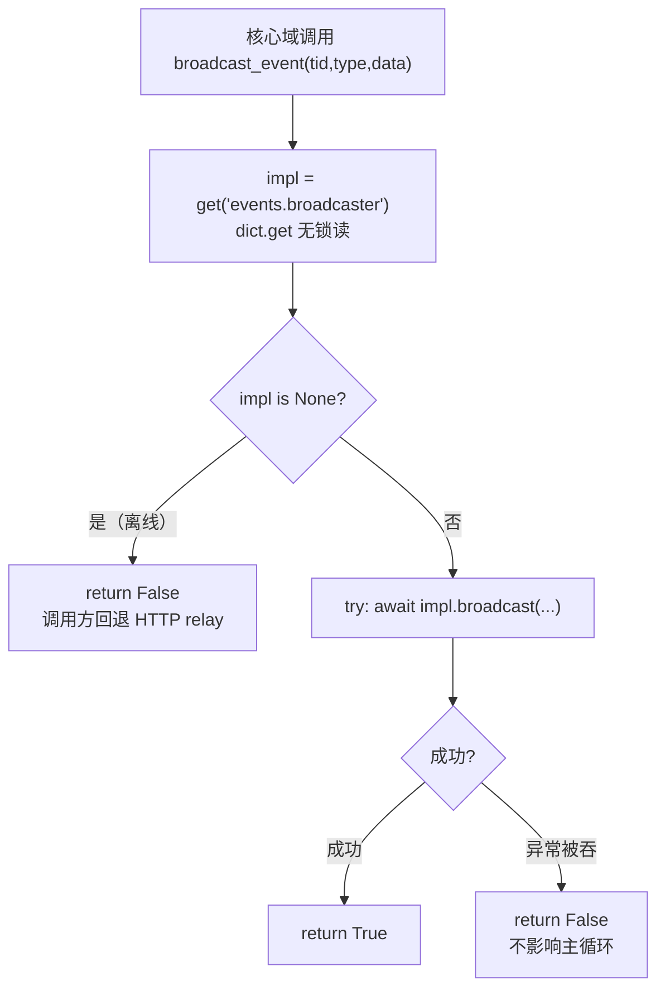

# runtime/ports.py — 端口机制讲解

> **文件路径**: `backend/packages/harness/agentflow/runtime/ports.py`
> **目录位置**: runtime → ports.py
> **职责**: R1 分层下，核心层反向调用应用层的唯一 sanctioned 桥（端口注册表 + 域访问器）

## 📑 目录

- [📋 结构图](#📋-结构图)
- [📤 关键导出](#📤-关键导出)
- [💡 设计思想](#💡-设计思想)
- [🎯 实用场景](#🎯-实用场景)
- [📊 顺序执行链流程图](#📊-顺序执行链流程图)
- [🧩 代码解析（成块对照 ports.py）](#🧩-代码解析成块对照-portspy)
- [❓ Q&A / 知识点](#❓-qa--知识点)
- [⚠️ 风险点](#⚠️-风险点)

## 📋 结构图

```text
┌────────────────────────────────────────────────────────────────┐
│ 核心层域代码（agents / collab / tools / ...）                    │
│      │  from agentflow.runtime import ports                    │
│      ▼                                                         │
│ ports.py（本文件）                                              │
│   _impls: dict[str, Any]   ← threading.Lock 保护的适配器注册表   │
│   register / register_many / unregister / get / is_registered   │
│   域访问器：无适配器 → no-op / None / False 安全降级             │
│      ▲                                                         │
│      │ create_app() 启动时一次性 register（幂等）                │
│      │ app/gateway/runtime_adapters.py               │
└────────────────────────────────────────────────────────────────┘

进程形态对比：
  Gateway 进程   → 启动期装配 → 每个端口解析到真实实现
  外部进程 / 单测 → 无人注册   → 每个访问器静默降级（不抛异常）
```

## 📤 关键导出

**注册表核心函数**

- `register(key, impl)`
- `register_many(entries)`
- `unregister(key)`
- `get(key)`
- `is_registered(key)`

**域访问器（当前最小骨架）**

- `broadcaster`（`_BroadcasterProxy` 单例，`await broadcaster.broadcast(...)`）
- `get_event_broadcaster() / get_broadcaster()`
- `broadcast_event(thread_id, event_type, data)`（async）
- `automation_langgraph_outer_rules()`

## 💡 设计思想

1. **R1 物理隔离**：`agentflow/` 下任何文件不得 `import app.*`。核心代码若需要应用层能力（SSE、通道、语音、诊断），一律改走本文件端口——把"随处 try import app"收敛成"只 import 本文件一处"。
2. **无适配器即降级**：每个访问器都是 `impl = get(...); if impl is None: 安全默认; else 调用`。这等价于它取代的旧版 `try: from app... except ImportError`，但语义集中、可测。
3. **端口 key 是稳定契约**：`events.broadcaster`、`automation.outer_rules` 这类字符串 key 改名 = 跨进程契约变更，必须同步注册端与基线文档。

## 🎯 实用场景

1. 核心域想往 SSE 订阅者推事件 → `await ports.broadcast_event(...)`；非 Gateway 进程自动返回 `False`，调用方可回退 HTTP relay。
2. 核心域想读自动化模式外层提示文案 → `ports.automation_langgraph_outer_rules()`，离线返回 `None`。
3. 测试想注入假实现 → 直接 `ports.register("events.broadcaster", fake)`，测完 `unregister`，无需起真 Gateway。

## 📊 顺序执行链流程图

```text
核心域调用 broadcast_event(tid, type, data)
│
▼
impl = get("events.broadcaster")        ← 模块级 dict.get（无锁读）
│
├── impl is None ──→ return False        ← 离线降级，不抛异常
│
▼
try: await impl.broadcast(tid, type, data)
│
├── 成功 ──→ return True
└── 异常 ──→ except 吞掉 ──→ return False（广播失败不拖垮主流程）
```

**Mermaid 版（GitHub / 飞书渲染）**：



## 🧩 代码解析（成块对照 ports.py）

> 读法：每块先贴**完整代码**，再看块下方的整块解析。代码与文件一致。

### 块 1：注册表核心

```python
_lock = threading.Lock()
_impls: dict[str, Any] = {}


def register(key: str, impl: Any) -> None:
    with _lock:
        _impls[key] = impl


def get(key: str) -> Any | None:
    return _impls.get(key)
```

**结构简析**：模块级 `_impls` 字典就是"端口 → 适配器"的全局注册表。写操作（register/unregister）持 `threading.Lock`，读操作用 `dict.get` 不加锁——注册只发生在启动期，读路径在热路径上要便宜。`register` 幂等：重复 `register` 同一 key 直接覆盖，配合应用层 `_registered` 标志避免重复装配。

### 块 2：events 域访问器

```python
async def broadcast_event(thread_id, event_type, data) -> bool:
    impl = get("events.broadcaster")
    if impl is None:
        return False
    try:
        await impl.broadcast(thread_id, event_type, data)
        return True
    except Exception:
        return False
```

**结构简析**：这是"端口访问器"的标准范式——**先查注册表 → 没有就给安全默认（False/None/no-op）→ 有才调用，且异常不外泄**。返回 bool 是刻意的：调用方拿 `False` 就知道"当前没有实时通道"，从而走备用路径，和旧版 `try import` 的行为完全一致。

**`broadcast_event(...)` 参数逐条解释**：
- `thread_id: str` —— 会话/线程标识，决定事件推给哪个 SSE 订阅者。
- `event_type: str` —— 事件类型字符串（如 `kb_citations`），前端按类型分发渲染。
- `data: dict` —— 事件负载，原样透传给下层 broadcaster。

### 块 3：模块级 broadcaster 代理

```python
class _BroadcasterProxy:
    async def broadcast(self, thread_id, event_type, data):
        impl = get("events.broadcaster")
        if impl is None:
            return
        await impl.broadcast(thread_id, event_type, data)


broadcaster = _BroadcasterProxy()
```

**结构简析**：把"每次查注册表"包进一个常驻代理对象，让旧调用点 `await broadcaster.broadcast(...)` 写法零改动即可继续用。离进程时它自己就是 no-op。

## ❓ Q&A / 知识点

### 1. 为什么用模块级全局注册表，而不是把适配器当参数层层传？

**一句话**：核心域调用点遍布几十个中间件/工具，传参会污染所有函数签名；全局注册表 + 降级语义是对旧版"随处 `try: from app...`"的收敛——从散落各处收敛到本文件一处。

### 2. 注册发生在什么时候？

**一句话**：应用层 `create_app()` 工厂开头调用一次 `register_runtime_adapters()`（模块级 `_registered` 标志保证幂等），先于挂任何路由。测试反复 `create_app()` 也只真正装一次。

### 3. 为什么访问器异常必须吞掉？

**一句话**：这些访问器嵌在 Agent 主循环 / 工具调用里，广播、日志这类"副作用"一旦抛异常就会拖垮主推理流程。约定：端口只负责"尽力而为"，失败 = 降级返回，绝不上抛。

## ⚠️ 风险点

1. 本文件严禁 `import app.*`——这是 R1 的物理保证，一旦破例分层即失效。
2. 访问器一律 `try/降级` 包裹，禁止让异常冒泡进核心主循环。
3. 端口 key 字符串（`events.broadcaster` 等）改名 = 跨进程契约变更，需同步 `runtime_adapters.py` 与基线文档。
4. 当前骨架只移植了 events / automation 代表访问器；stream_inject/middle_layer/proxy/reconcile/snapshot/defer/mirror/kb_citations/channels/speech/diagnostics/logs/goal/unattended 待 M8+ 出现真实应用层实现后按原版同构补齐。

---
_移植对齐 EvoFlow 端口机制（差异 #1），2026-10-13。_
